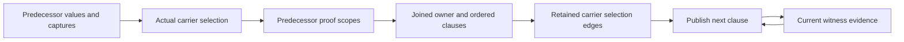

# BRA-567 active performance correction

Read this record and the work-on-bray-issues contract gate after compaction. Continue after checkpoints.
Work and pushes to feature/bra-567-async-root-orchestration are authorized. No full matrices.
This is the single current task record and computation model. Replace superseded findings.

## Acceptance contract

All five fixed formerly unfinished fixtures must take less than 500 ms for caller construction, checking and
lowering, excluding provider preparation and Rust builds. same_site_independent_second must also stay at or
below 10,000 combined condition comparisons and interner lookups, recursive work included. Count newly moved
producer, ingress and index-maintenance work too. Never meet the gate by relocating work outside measurement.

Preserve outcomes and rejection at observe(&value), source/import behavior, exact owner, dependency, current-value
and entry-snapshot scopes, qualified polarity, deterministic ordering and original budget/exhaustion behavior.
Unknowns, overwritten contents, borrowed prefixes and unavailable carriers grant nothing. Preserve authoritative
empty ownership alternatives and cleanup-feasibility rounds. Published values remain immutable. Reconstruction
is a last resort. No lock spans recursive inference. Style only at completed-batch finalization.

## Current mechanisms and evidence

The active migration uses immutable condition handles as exact proof keys. Raw query memos share exactly equal
ordered fact/polarity vectors. Their trusted/ordinary pair identifies a mixed scope. Requested, direct and
closure-derived proof results remain distinct. Memos preserve semantic costs and exhausted-budget results.
The deleted per-query interner no longer owns or reconstructs condition identity.

RetainedSnapshots indexes actual roots and paths. Owner queries exclude loans. Contents queries can follow
referents, but compare selected before/after contents and reject unknowns. Constructed bases are lineage, not
independently retained data. BooleanGraph shares immutable condition children. OrderedFacts preserves original
scan positions, DFS order, strictness, source precedence and budget charges. Its differential oracle covers
128 graphs and budgets 0-64. Solved flow outputs and actual cleanup parts/phases remain retained.

Current demand-driven proof checkpoint: optimized tooling build and all 552 checker tests pass. Fixed five
twice take 128-136 ms for task cases and 164/165 ms for the loop. Extra source/import controls pass at 159-169 ms.
Counters are compiled but disabled for timings. Frozen30 remains 29 pass and the same RawBuffer invalid acceptance
in 11.6 s. No full matrices ran. Source fixtures and expected rejection sites are unchanged.

The bounded loop probe records 1,766,114 comparisons: ordering 958,010, equality 761,465 and physical identity
46,639. Interner lookups are zero. It also records 561,077 key hashes, 83,611 prepared nodes, 148,592 child hashes,
1,280,802 comparison-pair lookups, 380,918 pair writes and 513,856 node-hash writes totaling 3,169,882 bytes.
These are overlapping cost categories, not time. The 10,000 goal remains far from achieved.

Moving unused unequal probes below equality and direct strict-result branches removes 21,001 constructions and
about 4 percent of comparisons against cefd3f958. Boolean derivation now skips already
asserted values. Refinement reuses the established root without repeating its positive-fact lookup. The batch
adds one nonblank production line and no tests. Independent inspection confirms unchanged budgets, precedence,
NaN rules, qualification and observation order. Existing regression oracles passed. Style has the same six
pre-existing errors. Format and diff checks pass. Temporary hooks are removed after measurement.

## Computation graph and cost model

Code tracing gives these dependencies:

- incoming_state -> propagate -> merge -> join_observations -> conditional_facts -> witness/proof queries
- transfer_block -> apply_operation -> current-value rewrites, witness refinement and retirement
- refine_witnesses -> available witnesses and pending deferred producers -> exact proof scopes
- retire_values -> retirement_dependents plus facts, clauses, allocations, private entries and selections
- final block entries -> publication operation replay -> diagnostics, effects and completion products

The inner Boolean prover already has a graph and change-driven queue. The repeated work spans its callers and
scope versions. The caller has 198 CFG blocks, two storage solves of 271 transfers, 327 raw inputs, 612 mixed
scopes, 13,032 public proof queries and 856 witness refinements. Only 12 new witness clauses result.
The structural probe finds 88 indices, 6,219 nodes, 9,633 child edges and 15,408 physical storage aliases.
Exact cross-index deduplication finds only 464 caller-observed structural nodes and 773 child edges. Of these,
446 are first encountered during the caller. The whole measured process registers 988 distinct indexed nodes.
This uses exact root payloads plus global child IDs, with hash collisions checked. Probe bookkeeping is excluded
from compiler counters. It observes indexed nodes, not every transient condition constructed outside an index.
The bounded source loop still rejects at the intended observe call. Production is c407abd16. This measurement
supports producer-owned handles but does not prove that handles alone reach the gate.
Outer lookup repetition includes scope preparation 21,318 requests/91 distinct nodes, proof 65,414/587,
refinement 21,682/153 and retirement 120,098/2,536. Distinct means index plus node, not evidence scope.
Retirement has 92,546 pure-cache hits and 27,552 misses. It removes 142/1,864 ordinary facts, 276/716 trusted
facts and 1,148/2,604 witness clauses. Many changes are real. Broad retirement skipping is unsound.

Minimize construction and maintenance plus sum(evaluation count * exclusive evaluation cost), with bounded
memory and the acceptance constraints above. Inclusive profile stages overlap and must not be summed.
Eliminating recursive comparisons below the root saves at most about 13 percent. Eliminating caller publication
replay saves at most about 23 percent before replacement costs. The target requires over 99.5 percent overall.
No existing measurement proves a 10,000 solution or an optimal representation.

The join detail distinguishes fixed selection edges from changing evidence:

Publication keeps the ordered evidence cycle. It cannot change current values or deferred inputs. A newly
inserted owner is an explicit potential endpoint, initially absent. Earlier owners' insertions are visible
when selecting the next owner. A parent with unknown contents does not retain invented child authority.
The current batch removes repeated discovery at this boundary, under 60 net production lines. The broader
replacement must remove repeated computation across versions, not add another cache or eager traversal.

## Typed dependency inventory

The graph is a hypergraph because several inputs can be required together. The following edges came from
parallel read-only source scans and parent inspection. They are semantic dependencies, not authority grants.

| Producer/consumer | Required edges and invalidation rules |
| --- | --- |
| Condition nodes and traversal | Distinguish data, owner, component, operand, live borrow, selector, descriptor and capture roles. Captured entries and descriptors are traversal barriers for some consumers. Live traversal keys include the live/nonlive role. Structural children alone are insufficient. |
| CurrentValues | Place -> current value, availability, ancestors/components and explicit descendant absence. Writes and retirement publish new bindings. Old terminal contents can remain readable without live authority. |
| Joins | Separate value and owner substitutions. Actual predecessor snapshots are not their general inverse. Complete snapshots, nested active-case guards and reached reference data remain separate. Conflicting source mappings become Unknown. Per-value and combined collectors have different original budgets. |
| Witness refinement | Each clause proof, including None, contributes to the whole proved-evidence set. That set plus ordinary facts determines guard discharge. Preserve carrier availability, owning bit, address-owner payload and original witness/producer order. Availability alone is not clause truth. |
| Carrier retirement | Carrier -> ordered captured ancestors, actual owned components and dependency places. Retained owners cut ancestor paths. Place -> current value -> observed paths applies to nonwrites. Match ancestor/descendant overlap, exclude siblings, and never infer ownership from equal contents. |
| Clause revocation | Clause -> address -> owner place -> current observation is distinct from carrier lifetime. Writes, retirement, raw referent mutation, root expiry and cleanup have different policies. Keep private-admission exceptions and all independent live supports for qualified facts. |
| Deferred evidence | Key by owner, execution site and captured entry. Retain owned arguments, extracted evidence and report snapshots. Selection/copy origins can expire while captured arguments remain. Possibility depends on absence of proved opposite guards. Captured ordinary facts grant no public authority. |
| Proof queries | Include exact and absent membership/complement probes, relational subjects, variants, ordered-path frontiers, alternatives and alias hypotheses. Changed hypotheses reset their results. Removed supports require rederivation, including conflicts and multiple independent supports. |
| Proof budgets | Preserve trusted-before-ordinary precedence, ordered DFS and Boolean short circuits. Fact rank and total length affect exhaustion even when truth is unchanged. Retain exact partial answers for incoming limits. Successful premises alone never justify reuse. |
| Substitution | Include failed exact hits and longer-prefix misses, replacement priority, value/owner role and capture barriers. Ordered children share one decreasing budget. Inserted snapshots are not recursively expanded. |
| Cleanup/publication | Cleanup uses retained owner, stable observations and proved truth. Private evidence needs the exact admitted carrier and entry scope. Final publication still needs intermediate checks, diagnostic deduplication, cancellation and completion products. Final block output alone is insufficient. |

Source owners are execution_guarantees/{condition,boolean,trusted_implication,ordered_facts,witness,evidence},
analysis/guarantee/{state,current,deferred,retirement,trusted/carriers,flow/merge,flow/witnesses}, and storage_flow.
Do not flatten these edges into a generic changed-owner test or cache resolved current values as immutable.

## Current representation and measured bottleneck

ExecutionCondition retains an immutable node with one derived structural hash. Arc child slots and operand arrays
preserve physical observation visits. NodeIdentity keys the borrowed handle slot, never the node allocation.
Equality rejects unequal hashes then checks exact structure. Ordering preserves declaration/field/child order.
Invocation-local node-pair memoization bounds shared-DAG comparison without merging independent occurrences.
There is no condition interner, storage-key translation, global factory or second hashing schema. Keep these
invariants and the collision, occurrence-slot and independent-DAG regression controls.

The edge probe finds only 36 unchanged-source repetitions in 658 storage-flow propagations. Before this batch,
their inclusive cost was at most 198,844 of 5,114,981 instrumented events, including merges that cannot be cached.
Edge-result retention cannot be the main route to the gate. Do not implement it next.

Caller-attributed construction now identifies implication::comparison_is_implied's known lookup as the largest
site, with 38,294 operation roots. Raw inverse lookup in condition/proof constructs 5,400 more. Substitution and
equality rewrite operation rebuilding contributes 4,868 and 4,228. Scalar/projection paths are smaller. The
remaining dominant query construction has an actual consumer, not merely a factory-site attribution.

Normalized Boolean shape is not sufficient for a no-op rewrite shortcut. For example, a balanced conjunction
built from 128 flat leaves can fit the original 256-work limit but exhaust it when flattened and rebuilt again.
Preserve child traversal, normalization and exhaustion even when final children are unchanged. Published join
formulas cannot silently become negative atom facts. Proving a normalized contrary is not generally equivalent
to asking whether the original condition proves false under the original precedence and budgets.

## Next direct-membership contract

Use the existing ProofMemo evidence index for exact transient query membership. Replace its Boolean value with
raw first-set membership for both signs and the existing filtered explicit answer. Ingest unknown-containing
keys and contradictory signs into raw membership. Compute explicit answers with the same unknown exclusion,
ordinary qualifier exclusion and true-before-false precedence. A raw query must use the exact single-view memo
for its assumptions. Never reuse a mixed memo's first-set facts as its ordinary-set membership.

Factor the operation normalizer once into a retained/folded ExecutionCondition or an unpublished condition node.
Reuse the existing kind-plus-hash node representation. Existing operation construction materializes the result
without normalizing again. Exact lookup hashes and compares that node using the same cached-hash and pair-aware
comparison machinery as a published handle. Do not duplicate the kind/child hashing schema, create an operator
cache or register transient query nodes in BooleanGraph, observations or ownership products.

All normalization branches remain shared: computed-value operands, unknown checks, literals, nullable/tag
recursion, Boolean equality, double negation, equality complement and bounded Boolean rebuilding. A normalized
Boolean/Unknown/operand result still asks whether that exact fact and sign are stored. It is not an intrinsic
truth query. Raw inverse probes bypass normalization and test true then false, as before.

The no-memo proof path needs one scope-owned memo at the proof entry, shared by comparison, inverse and recursive
queries. Do not build and discard a comparison-local index before the inverse query. Preserve the original
one-unit entry charge and exact completed/exhausted results. A zero-budget raw proof remains None. Index
construction and all new lookups count, including standalone proof. No lock spans recursive inference.

Preserve operand slot creation for published operations. Sharing original operand storage is safe only for
unpublished lookup when order and computed values match. Do not add borrowed hash logic for reversed operands
or shortcut normalizing constructors merely to remove allocations. Initial scope is exact lookup without an
outer node allocation, using hashbrown Equivalent and the existing structural schema. Reconsider if this needs
more than 200 nonblank production lines, another fact index or a parallel normalization implementation.

Regression oracles remain fixed: checker tests, five fixtures with observe rejection, source/import ownership
controls and frozen30. Extend existing evidence/normalization tests for both raw signs, unknown keys, filtered
ordinary Trusted facts, normalized literal membership, matching collision hashes and no-memo budgets. Preserve
ordered relation rank/length/DFS costs. Measure comparison, root/child/key hashing, pair writes and ingress work.
The lookup must not remove counted root work merely by moving it out of ExecutionCondition::new.

## Fixed evidence and broader work

Use optimized tooling, shared target/cargo and pinned target/toolchains/llvm/active. Select products from a
successful proof-build.jsonl. Native runs stay outside the sandbox. Fixed cases are bounded to 10 seconds.
proof-unfinished.json freezes five identities. correction-frozen30.json freezes membership and correction-current.json
maps names. Fixed 920 is comparison.txt plus verification.json additions. Keep one current count, timing and
regression result plus one probe patch. Remove hooks and stale raw outputs after verification. Build without
hooks for final goal evidence, not every checkpoint. Retain the checker-only non-incremental override. Never
clean shared Cargo storage. Do not run full matrices under the current scope.

BRA-567 still needs generic borrowed-field completion mappings, inactive conditional result shapes and RawBuffer
payload dependencies. Keep d302124's deferred-admission control. Then finish maintainability, owned/deferred
matrices, frozen30, fixed920 and source/native gates. Verify root/main authority, cleanup before terminal
publication, normal/panic/cancellation, rollback once, services through static disposal, synchronous control and
native archive/link removal of Rust orchestration. Independent draft-PR review precedes ready/In Review. Close
only after merge. Six existing style errors remain: wildcard flow/invalidation and oversized flow/merge,
storage_flow cleanup/core, execution_guarantees/portable and tooling output/diagnostic/json/argument.
