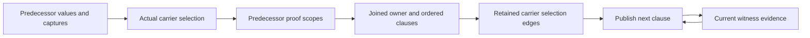

# BRA-567 active performance correction

Read this record and the work-on-bray-issues contract gate after compaction. Continue after checkpoints.
Work and pushes to feature/bra-567-async-root-orchestration are authorized. No full matrices.
This is the single current task record and computation model. Replace superseded findings.

## Acceptance contract

All five fixed formerly unfinished fixtures must take less than 500 ms for caller construction, checking and
lowering, excluding provider preparation and Rust builds. same_site_independent_second must also stay at or
below 10,000 combined condition comparisons and interner lookups, recursive work included. Count newly moved
producer, ingress and index-maintenance work too. Never meet the gate by relocating work outside measurement.
While the user shares this computer, focus on counts and keep timings informational. Recheck the timing gate
when the machine is idle. Bounded runs still apply.

Preserve outcomes and rejection at observe(&value), source/import behavior, exact owner, dependency, current-value
and entry-snapshot scopes, qualified polarity, deterministic ordering and original budget/exhaustion behavior.
Unknowns, overwritten contents, borrowed prefixes and unavailable carriers grant nothing. Preserve authoritative
empty ownership alternatives and cleanup-feasibility rounds. Published values remain immutable. Reconstruction
is a last resort. No lock spans recursive inference. Style only at completed-batch finalization.

## Current mechanisms and evidence

The active migration uses immutable condition handles as exact proof keys. Raw query memos share exactly equal
ordered fact/polarity vectors. Their trusted/ordinary pair identifies a mixed scope. Requested, direct and
closure-derived proof results remain distinct. Memos preserve semantic costs and exhausted-budget results.
The deleted per-query interner no longer owns or reconstructs condition identity.

RetainedSnapshots indexes actual roots and paths. Owner queries exclude loans. Contents queries can follow
referents, but compare selected before/after contents and reject unknowns. Constructed bases are lineage, not
independently retained data. BooleanGraph shares immutable condition children. OrderedFacts preserves original
scan positions, DFS order, strictness, source precedence and budget charges. Its differential oracle covers
128 graphs and budgets 0-64. Solved flow outputs and actual cleanup parts/phases remain retained.

Current retention checkpoint: 556 checker tests pass. Fixed five pass at 205-227 ms for task cases and
262 ms for the loop. Three complementary loops pass at 256-284 ms. Counters were compiled but disabled for
timing. Frozen30 remains 29 pass and the same RawBuffer invalid acceptance in 19.03 s. No full matrices ran.
The bounded loop records 1,522,816 comparisons, zero interner lookups, 622,350 key hashes, 80,157 nodes,
144,426 child hashes, 1,057,060 pair lookups, 360,084 pair writes and 503,388 hash writes totaling 3,096,106 bytes.
Against the unchanged detailed baseline, comparisons fall 33,480 and key hashes rise 9,194. These categories
overlap and do not measure elapsed time. The 10,000 goal remains far from achieved. Style has the same six
existing errors. Format/diff checks pass. Temporary hooks are removed after measurement.

## Computation graph and cost model

Code tracing gives these dependencies:

- incoming_state -> propagate -> merge -> join_observations -> conditional_facts -> witness/proof queries
- transfer_block -> apply_operation -> current-value rewrites, witness refinement and retirement
- refine_witnesses -> available witnesses and pending deferred producers -> exact proof scopes
- retire_values -> retirement_dependents plus facts, clauses, allocations, private entries and selections
- final block entries -> publication operation replay -> diagnostics, effects and completion products

The inner Boolean prover already has a graph and change-driven queue. The repeated work spans its callers and
scope versions. The caller has 198 CFG blocks, two storage solves of 271 transfers, 327 raw inputs, 612 mixed
scopes, 13,032 public proof queries and 856 witness refinements. Only 12 new witness clauses result.
The structural probe finds 88 indices, 6,219 nodes, 9,633 child edges and 15,408 physical storage aliases.
Exact cross-index deduplication finds only 464 caller-observed structural nodes and 773 child edges. Of these,
446 are first encountered during the caller. The whole measured process registers 988 distinct indexed nodes.
This uses exact root payloads plus global child IDs, with hash collisions checked. Probe bookkeeping is excluded
from compiler counters. It observes indexed nodes, not every transient condition constructed outside an index.
The bounded source loop still rejects at the intended observe call. Production is c407abd16. This measurement
supports producer-owned handles but does not prove that handles alone reach the gate.
Outer lookup repetition includes scope preparation 21,318 requests/91 distinct nodes, proof 65,414/587,
refinement 21,682/153 and retirement 120,098/2,536. Distinct means index plus node, not evidence scope.
Retirement has 92,546 pure-cache hits and 27,552 misses. It removes 142/1,864 ordinary facts, 276/716 trusted
facts and 1,148/2,604 witness clauses. Many changes are real. Broad retirement skipping is unsound.

Minimize construction and maintenance plus sum(evaluation count * exclusive evaluation cost), with bounded
memory and the acceptance constraints above. Inclusive profile stages overlap and must not be summed.
Eliminating recursive comparisons below the root saves at most about 13 percent. Eliminating caller publication
replay saves at most about 23 percent before replacement costs. The target requires over 99.5 percent overall.
No existing measurement proves a 10,000 solution or an optimal representation.

The join detail distinguishes fixed selection edges from changing evidence:

Publication keeps the ordered evidence cycle. It cannot change current values or deferred inputs. A newly
inserted owner is an explicit potential endpoint, initially absent. Earlier owners' insertions are visible
when selecting the next owner. A parent with unknown contents does not retain invented child authority.
Retained selection edges remove repeated discovery here. Further work must remove repeated computation
across versions while preserving ordered publication and actual predecessor evidence.

## Typed dependency inventory

The graph is a hypergraph because several inputs can be required together. The following edges came from
parallel read-only source scans and parent inspection. They are semantic dependencies, not authority grants.

| Producer/consumer | Required edges and invalidation rules |
| --- | --- |
| Condition nodes and traversal | Distinguish data, owner, component, operand, live borrow, selector, descriptor and capture roles. Captured entries and descriptors are traversal barriers for some consumers. Live traversal keys include the live/nonlive role. Structural children alone are insufficient. |
| CurrentValues | Place -> current value, availability, ancestors/components and explicit descendant absence. Writes and retirement publish new bindings. Old terminal contents can remain readable without live authority. |
| Joins | Separate value and owner substitutions. Actual predecessor snapshots are not their general inverse. Complete snapshots, nested active-case guards and reached reference data remain separate. Conflicting source mappings become Unknown. Per-value and combined collectors have different original budgets. |
| Witness refinement | Each clause proof, including None, contributes to the whole proved-evidence set. That set plus ordinary facts determines guard discharge. Preserve carrier availability, owning bit, address-owner payload and original witness/producer order. Availability alone is not clause truth. |
| Carrier retirement | Carrier -> ordered captured ancestors, actual owned components and dependency places. Retained owners cut ancestor paths. Place -> current value -> observed paths applies to nonwrites. Match ancestor/descendant overlap, exclude siblings, and never infer ownership from equal contents. |
| Clause revocation | Clause -> address -> owner place -> current observation is distinct from carrier lifetime. Writes, retirement, raw referent mutation, root expiry and cleanup have different policies. Keep private-admission exceptions and all independent live supports for qualified facts. |
| Deferred evidence | Key by owner, execution site and captured entry. Retain owned arguments, extracted evidence and report snapshots. Selection/copy origins can expire while captured arguments remain. Possibility depends on absence of proved opposite guards. Captured ordinary facts grant no public authority. |
| Proof queries | Include exact and absent membership/complement probes, relational subjects, variants, ordered-path frontiers, alternatives and alias hypotheses. Changed hypotheses reset their results. Removed supports require rederivation, including conflicts and multiple independent supports. |
| Proof budgets | Preserve trusted-before-ordinary precedence, ordered DFS and Boolean short circuits. Fact rank and total length affect exhaustion even when truth is unchanged. Retain exact partial answers for incoming limits. Successful premises alone never justify reuse. |
| Substitution | Include failed exact hits and longer-prefix misses, replacement priority, value/owner role and capture barriers. Ordered children share one decreasing budget. Inserted snapshots are not recursively expanded. |
| Cleanup/publication | Cleanup uses retained owner, stable observations and proved truth. Private evidence needs the exact admitted carrier and entry scope. Final publication still needs intermediate checks, diagnostic deduplication, cancellation and completion products. Final block output alone is insufficient. |

Source owners are execution_guarantees/{condition,boolean,trusted_implication,ordered_facts,witness,evidence},
analysis/guarantee/{state,current,deferred,retirement,trusted/carriers,flow/merge,flow/witnesses}, and storage_flow.
Do not flatten these edges into a generic changed-owner test or cache resolved current values as immutable.

## Current representation and measured bottleneck

ExecutionCondition retains an immutable node with one derived structural hash. Arc child slots and operand arrays
preserve physical observation visits. NodeIdentity keys the borrowed handle slot, never the node allocation.
Equality rejects unequal hashes then checks exact structure. Ordering preserves declaration/field/child order.
Invocation-local node-pair memoization bounds shared-DAG comparison without merging independent occurrences.
There is no condition interner, storage-key translation, global factory or second hashing schema. Keep these
invariants and the collision, occurrence-slot and independent-DAG regression controls.

The edge probe finds only 36 unchanged-source repetitions in 658 storage-flow propagations. Before this batch,
their inclusive cost was at most 198,844 of 5,114,981 instrumented events, including merges that cannot be cached.
Edge-result retention cannot be the main route to the gate. Do not implement it next.

Caller-attributed construction still identifies implication::comparison_is_implied's known lookup as the largest
site. These roots are now unpublished but normalization and hashing still cost work. Removing an allocation
does not remove this computation. Substitution and equality rewriting also rebuild operations.

Normalized Boolean shape is not sufficient for a no-op rewrite shortcut. For example, a balanced conjunction
built from 128 flat leaves can fit the original 256-work limit but exhaust it when flattened and rebuilt again.
Preserve child traversal, normalization and exhaustion even when final children are unchanged. Published join
formulas cannot silently become negative atom facts. Proving a normalized contrary is not generally equivalent
to asking whether the original condition proves false under the original precedence and budgets.

## Direct-membership invariants

ProofMemo retains raw membership for both signs separately from filtered explicit answers. Preserve unknown
keys, ordinary qualifier exclusion and true-before-false precedence. Raw lookup uses its exact single-view
scope. Operation construction and transient lookup share one normalizer and structural hash/compare schema.
Transient queries are not published into BooleanGraph or ownership products. All normalization and budget
branches remain shared, including the one-unit proof-entry charge. Published operand slots remain distinct.
No lock spans inference. Count lookup, normalization and index construction, including standalone proofs.

## Next unresolved producer boundary

The completed growth/fixture audit covers b4b5a76f5..15380b43b.
The range adds 9,512 net lines: about 1,921 production, 7,456 tests and 135 other. The same 372 trusted-contract
test names survive reorganization, with about 3,300 extra lines from splitting and formatting existing code.
Retain genuine bug regressions and distinct contracts. Intermediate debugging history alone does not justify
another test. Consolidate repeated fixture setup instead of removing distinct scenarios or compressing Bray.
Fixture consolidation shares exact scalar-borrow, receipt and owner-producer declarations, activation checks
and diagnostic outcome assertions. It removes 313 net test/infrastructure lines without removing cases.
Optimized build passes. The bounded 33 affected tests finish in 39.15 s: 25 pass, 8 activation failures.
Five require pool.protocol_access, three fail earlier type/call selection. Their 19 source templates are
byte-identical and extracted assertions are equivalent, indicating existing failures rather than changed
expectations. Compact details are in proof-fixture-result.json. These controls remain unresolved. Style has
the same six existing errors, format/diff checks pass. No compiler behavior or fixed-five/frozen30 cases changed.
Resume producer graph optimization. Do not expand this test consolidation into fixing unrelated fixtures.

Evidence snapshots already preserve Arc identity for clones, duplicate insertions and no-op retention.
Fresh keys arise at state::join_values when any substitution changes, flow/merge's intersection plus
alternative insertion, deferred refinement's entry/current/selection/projected-capture union, and per-carrier
proved-evidence construction in witness::derived_conditions and flow/witnesses. These are distinct producers.

BTree ordering governs insertion, difference/take limits, proof rank and semantic state equality.
Hash membership removes query searches, not this ordered producer work. Restoring an older equal snapshot
needs unchanged fact expansion, observation occurrences and budgets, not just equal keys. Entry/current
scope reuse requires an established producer relation. Historical entry, retirement and copy projection
can change either set, so do not infer a general superset or add a union cache.

Substitution maps now retain their change predicate with immutable entries. Value, owner and recursive
identity consumers reuse that metadata, including unscoped calls. Identity pins, per-root budgets, separate
value/owner memos and snapshot capture boundaries are unchanged. Inactive-guard and conditional-alias consumers
share one ordered availability/path set and preserve their separate iteration limits.

Next investigate shared retirement predicate evaluation across condition roots. Root-level RetirementQueries
memoizes six answers, but their implementations repeatedly traverse shared subgraphs and query retained data.
A scope-owned DAG evaluation must preserve observation/only/live traversal differences, pruning and live-role
keys. Close that transition contract before edits. Replace repeated walks, without transitive descendant lists,
recursive Rust stack growth or another parallel child schema. Existing NodeIdentity denotes a handle slot,
not allocation identity. Do not change physical occurrence semantics globally. Reverse graph rebuilding and
edge-result caching are ruled out as the next target by measured cost.

The detailed retirement probe on unchanged 1b262f9bd records 1,556,296 comparisons. Retirement graph
reconstruction is only 152, closure 14,846, snapshot-index construction 8,151, snapshot queries 112,634,
observation queries 68,004, entry filtering 12,652 and remaining retirement 190,919 with 162,208 key hashes.
Cleanup-retirement/private-admission are unused in this fixture. This rules out a reverse-graph rewrite as
the next optimization. The raw parent total is about 407k. Other major costs remain joins 244k, substitution
236k and scope keys 183k. Full exclusive counters are in proof-count-current.json.

Retained root sets now own owner/content queries, replacing external memo wrappers. Empty-context answers
return before hashing. Root insertion invalidates every derived answer through the existing index lifetime.
Owner, contents and inline-contents modes stay distinct. Between-snapshot queries depend on both actual sets
and keep a separate pair scope. Remove outer wrappers rather than stacking caches. Preserve loans, unknowns,
selected projections, overwritten contents, proof budgets and current-vs-entry boundaries. Existing retention
and retirement tests, fixed five and frozen30 are the oracles. The existing retention test also checks cached
negative answers after insertion. No test identity was added. Count index maintenance and retained query memory.

Join candidates remain unimplemented. One actual-value traversal could supply observation events to ownership
and conditional-fact construction, but predecessor absence evidence and missing-vs-Unknown results differ.
A shared ordered partition could replace ordinary left/right differences plus intersection after
join_observations. Preserve left handles, both branch limits, exact order and unchanged snapshot identity.
Count full partition/rebuild work, including imbalanced sets. Structural IDs alone save at most about 13 percent.
Allocation order cannot replace semantic order because bounded selection and normalization depend on it.

The scope-pair producer is ExecutionProofCache::prepare. Each new pair prepares DerivedFacts through
prepare_trusted_conditions and BooleanGraph::new, then AlternativeProof builds subjects and an intrinsic
baseline. Formula children, related subjects and intrinsic truth are structural. Active descendants,
qualified roots, assertions, publication and propagation order belong to the scope. Registration includes
observation owners and Trusted children even without Boolean edges. IDs follow child-first traversal of
ordered qualifying roots. A shared potential graph cannot activate every node or change that order.

Witness refinement has two proof scopes. First prove every clause, admitting only Some(true), then expand
admitted clauses with assume. Second use that evidence plus ordinary facts to refine every original clause,
including ones not admitted initially. Another admitted clause may establish them. Retain each source's
owning bit and address supports. Guard replacement inserts closure facts before ordinary facts, with later
entries winning, and preserves Trusted barriers. Static witness structure can be shared, but synthesized
observations, failed/absent proofs, ordinary ordering and exhausted budgets remain dynamic dependencies.

## Fixed evidence and broader work

Use optimized tooling, shared target/cargo and pinned target/toolchains/llvm/active. Select products from a
successful proof-build.jsonl. Native runs stay outside the sandbox. Fixed cases are bounded to 10 seconds.
proof-unfinished.json freezes five identities. correction-frozen30.json freezes membership and correction-current.json
maps names. Fixed 920 is comparison.txt plus verification.json additions. Keep one current count, timing and
regression result plus one probe patch. Remove hooks and stale raw outputs after verification. Build without
hooks for final goal evidence, not every checkpoint. Retain the checker-only non-incremental override. Never
clean shared Cargo storage. Do not run full matrices under the current scope.

BRA-567 still needs generic borrowed-field completion mappings, inactive conditional result shapes and RawBuffer
payload dependencies. Keep d302124's deferred-admission control. Then finish maintainability, owned/deferred
matrices, frozen30, fixed920 and source/native gates. Verify root/main authority, cleanup before terminal
publication, normal/panic/cancellation, rollback once, services through static disposal, synchronous control and
native archive/link removal of Rust orchestration. Independent draft-PR review precedes ready/In Review. Close
only after merge. Six existing style errors remain: wildcard flow/invalidation and oversized flow/merge,
storage_flow cleanup/core, execution_guarantees/portable and tooling output/diagnostic/json/argument.
