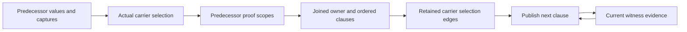

# BRA-567 active performance correction

Read this record and the work-on-bray-issues contract gate after compaction. Continue after checkpoints.
Work and pushes to feature/bra-567-async-root-orchestration are authorized. No full matrices.
This is the single current task record and computation model. Replace superseded findings.

## Acceptance contract

All five fixed formerly unfinished fixtures must take less than 500 ms for caller construction, checking and
lowering, excluding provider preparation and Rust builds. same_site_independent_second must also stay at or
below 10,000 combined condition comparisons and interner lookups, recursive work included. Count newly moved
producer, ingress and index-maintenance work too. Never meet the gate by relocating work outside measurement.

Preserve outcomes and rejection at observe(&value), source/import behavior, exact owner, dependency, current-value
and entry-snapshot scopes, qualified polarity, deterministic ordering and original budget/exhaustion behavior.
Unknowns, overwritten contents, borrowed prefixes and unavailable carriers grant nothing. Preserve authoritative
empty ownership alternatives and cleanup-feasibility rounds. Published values remain immutable. Reconstruction
is a last resort. No lock spans recursive inference. Style only at completed-batch finalization.

## Current mechanisms and evidence

The active migration uses immutable condition handles as exact proof keys. Raw query memos share exactly equal
ordered fact/polarity vectors. Their trusted/ordinary pair identifies a mixed scope. Requested, direct and
closure-derived proof results remain distinct. Memos preserve semantic costs and exhausted-budget results.
The deleted per-query interner no longer owns or reconstructs condition identity.

RetainedSnapshots indexes actual roots and paths. Owner queries exclude loans. Contents queries can follow
referents, but compare selected before/after contents and reject unknowns. Constructed bases are lineage, not
independently retained data. BooleanGraph shares immutable condition children. OrderedFacts preserves original
scan positions, DFS order, strictness, source precedence and budget charges. Its differential oracle covers
128 graphs and budgets 0-64. Solved flow outputs and actual cleanup parts/phases remain retained.

Native-handle checkpoint: optimized tooling build and all 552 checker tests pass. Fixed five twice take
127-136 ms for task cases and 169/171 ms for the loop. Extra source/import controls pass at 165-178 ms.
These final timings have temporary counters compiled but disabled. Frozen30 remains 29 pass and the same
RawBuffer invalid acceptance, in 11.7 s. No full matrices ran. The prior uninstrumented pre-finalization batch
was 105-149 ms, so do not claim a final production speedup from those earlier timings.

The final bounded loop probe records 1,844,579 comparisons: ordering 1,035,376, equality 762,573 and physical
identity 46,630. Interner lookups are zero because the interner is removed. Additional work is 561,908 native
key hashes, 104,612 constructed nodes, 190,594 child hashes and 1,357,450 comparison-pair lookups. Node hashing
writes 660,863 payload chunks totaling 4,051,924 bytes. Comparison-pair memoization also performs 394,975 writes. These
categories overlap in cost and must not be summed as time. The 10,000 gate is nowhere near satisfied.

Compared with the prior 2,215,658 comparison/interner count, this removes one reconstruction mechanism but
leaves extensive repeated production and querying. Construction counts include transient unindexed nodes,
so they cannot be divided by the old 464-node indexed cardinality to claim an exact duplication factor.
The batch removes 179 nonblank production lines and 43 test lines. It removes obsolete interner-only tests,
retains the ordering/scalability oracles and adds native collision/child-slot checks. Inline Bray literals are
unchanged. Style has the same six pre-existing errors. Format and diff checks pass. Probe hooks are removed.

## Computation graph and cost model

Code tracing gives these dependencies:

- incoming_state -> propagate -> merge -> join_observations -> conditional_facts -> witness/proof queries
- transfer_block -> apply_operation -> current-value rewrites, witness refinement and retirement
- refine_witnesses -> available witnesses and pending deferred producers -> exact proof scopes
- retire_values -> retirement_dependents plus facts, clauses, allocations, private entries and selections
- final block entries -> publication operation replay -> diagnostics, effects and completion products

The inner Boolean prover already has a graph and change-driven queue. The repeated work spans its callers and
scope versions. The caller has 198 CFG blocks, two storage solves of 271 transfers, 327 raw inputs, 612 mixed
scopes, 13,032 public proof queries and 856 witness refinements. Only 12 new witness clauses result.
The structural probe finds 88 indices, 6,219 nodes, 9,633 child edges and 15,408 physical storage aliases.
Exact cross-index deduplication finds only 464 caller-observed structural nodes and 773 child edges. Of these,
446 are first encountered during the caller. The whole measured process registers 988 distinct indexed nodes.
This uses exact root payloads plus global child IDs, with hash collisions checked. Probe bookkeeping is excluded
from compiler counters. It observes indexed nodes, not every transient condition constructed outside an index.
The bounded source loop still rejects at the intended observe call. Production is c407abd16. This measurement
supports producer-owned handles but does not prove that handles alone reach the gate.
Outer lookup repetition includes scope preparation 21,318 requests/91 distinct nodes, proof 65,414/587,
refinement 21,682/153 and retirement 120,098/2,536. Distinct means index plus node, not evidence scope.
Retirement has 92,546 pure-cache hits and 27,552 misses. It removes 142/1,864 ordinary facts, 276/716 trusted
facts and 1,148/2,604 witness clauses. Many changes are real. Broad retirement skipping is unsound.

Minimize construction and maintenance plus sum(evaluation count * exclusive evaluation cost), with bounded
memory and the acceptance constraints above. Inclusive profile stages overlap and must not be summed.
Eliminating recursive comparisons below the root saves at most about 13 percent. Eliminating caller publication
replay saves at most about 23 percent before replacement costs. The target requires over 99.5 percent overall.
No existing measurement proves a 10,000 solution or an optimal representation.

The join detail distinguishes fixed selection edges from changing evidence:

Publication keeps the ordered evidence cycle. It cannot change current values or deferred inputs. A newly
inserted owner is an explicit potential endpoint, initially absent. Earlier owners' insertions are visible
when selecting the next owner. A parent with unknown contents does not retain invented child authority.
The current batch removes repeated discovery at this boundary, under 60 net production lines. The broader
replacement must remove repeated computation across versions, not add another cache or eager traversal.

## Typed dependency inventory

The graph is a hypergraph because several inputs can be required together. The following edges came from
parallel read-only source scans and parent inspection. They are semantic dependencies, not authority grants.

| Producer/consumer | Required edges and invalidation rules |
| --- | --- |
| Condition nodes and traversal | Distinguish data, owner, component, operand, live borrow, selector, descriptor and capture roles. Captured entries and descriptors are traversal barriers for some consumers. Live traversal keys include the live/nonlive role. Structural children alone are insufficient. |
| CurrentValues | Place -> current value, availability, ancestors/components and explicit descendant absence. Writes and retirement publish new bindings. Old terminal contents can remain readable without live authority. |
| Joins | Separate value and owner substitutions. Actual predecessor snapshots are not their general inverse. Complete snapshots, nested active-case guards and reached reference data remain separate. Conflicting source mappings become Unknown. Per-value and combined collectors have different original budgets. |
| Witness refinement | Each clause proof, including None, contributes to the whole proved-evidence set. That set plus ordinary facts determines guard discharge. Preserve carrier availability, owning bit, address-owner payload and original witness/producer order. Availability alone is not clause truth. |
| Carrier retirement | Carrier -> ordered captured ancestors, actual owned components and dependency places. Retained owners cut ancestor paths. Place -> current value -> observed paths applies to nonwrites. Match ancestor/descendant overlap, exclude siblings, and never infer ownership from equal contents. |
| Clause revocation | Clause -> address -> owner place -> current observation is distinct from carrier lifetime. Writes, retirement, raw referent mutation, root expiry and cleanup have different policies. Keep private-admission exceptions and all independent live supports for qualified facts. |
| Deferred evidence | Key by owner, execution site and captured entry. Retain owned arguments, extracted evidence and report snapshots. Selection/copy origins can expire while captured arguments remain. Possibility depends on absence of proved opposite guards. Captured ordinary facts grant no public authority. |
| Proof queries | Include exact and absent membership/complement probes, relational subjects, variants, ordered-path frontiers, alternatives and alias hypotheses. Changed hypotheses reset their results. Removed supports require rederivation, including conflicts and multiple independent supports. |
| Proof budgets | Preserve trusted-before-ordinary precedence, ordered DFS and Boolean short circuits. Fact rank and total length affect exhaustion even when truth is unchanged. Retain exact partial answers for incoming limits. Successful premises alone never justify reuse. |
| Substitution | Include failed exact hits and longer-prefix misses, replacement priority, value/owner role and capture barriers. Ordered children share one decreasing budget. Inserted snapshots are not recursively expanded. |
| Cleanup/publication | Cleanup uses retained owner, stable observations and proved truth. Private evidence needs the exact admitted carrier and entry scope. Final publication still needs intermediate checks, diagnostic deduplication, cancellation and completion products. Final block output alone is insufficient. |

Source owners are execution_guarantees/{condition,boolean,trusted_implication,ordered_facts,witness,evidence},
analysis/guarantee/{state,current,deferred,retirement,trusted/carriers,flow/merge,flow/witnesses}, and storage_flow.
Do not flatten these edges into a generic changed-owner test or cache resolved current values as immutable.

## Active native-handle migration contract

Replace the recursive public enum with ExecutionCondition wrapping an immutable node. One public
ExecutionConditionKind retains every existing root field, Arc-wrapped child slot, operand slice and field array.
The node derives its structural hash once from the kind and already prepared child hashes. No factory,
canonical-ID registry, weak table, per-body import or snapshot namespace is needed. Raw constructors preserve
independent occurrences. Clone preserves existing child sharing. NodeIdentity remains the address of the
borrowed handle slot, never the node pointer or hash. This avoids changing budget-sensitive observation visits.

Equality first accepts the same node, rejects unequal hashes, then compares exact structure. Invocation-local node-pair memoization bounds repeated shared-DAG comparisons.
Leaf comparisons allocate no memo entries. Hash collisions
never establish equality. Ordering keeps the original declaration, field and child order. Hash values feed
compilation fingerprints, so they must remain deterministic across equivalent nodes and reused snapshots.
Constants may share immutable node allocations while callers retain their own wrapper slots. Published nodes
never mutate. Portable Typed/Call decoding must construct its final immutable value rather than edit a field.

Remove ConditionIndex, StorageKey/StorageLookup and per-query interning. Memos and ordered relations use
native handles as exact hash keys. Boolean graphs retain only their own local vector/queue IDs and preserve
child registration order, fact order, polarity, DFS and all budget charges. Do not schedule from hash iteration.
Retain unchanged producer results instead of rebuilding them. Do not introduce forwarding factories or a second
child schema. Target net production reduction, with at most 200 added nonblank production lines if unavoidable.
Reconsider if migration needs context threading, duplicate occurrence graphs or new mutable identity machinery.

Regression oracles remain fixed: checker tests, fixed five with intended observe rejection, source/import owner
controls and frozen30. Extend existing structural hashing/identity checks for independent equal DAGs, forced
collisions, shared versus copied child slots, Eq/Ord consistency and existing budget results. Count all producer
hash/edge work alongside comparisons and removed interner work. No performance success until measured. The old independent shared-DAG scalability and derived-order
oracles remain, together with collision and physical child-slot observation controls.

The small 464-node indexed graph supports this representation change, not a claim that it alone reaches 10,000.
Subsequent scheduling must retain actual typed dependencies, failed obligations, budget rank/length effects and
ordered witness publication. Existing witness refinement already keys the exact witness and both full scopes.
The 856 misses cannot be skipped from the 12 new-clause count, because refinement can still publish new facts.
No narrower sufficient identity has been established.

The fixed-point solver retains block outputs but repeats edge transforms before comparing merged inputs.
The bounded probe now measures 658 storage-flow propagations across eight solves. Only 36 repeat the same
edge/source-output version. Their inclusive cost is 198,844 counted events, including target-dependent merges
that caching cannot remove. That is at most 3.9 percent of the 5,114,981 instrumented events, not a wall-time
estimate. Solve-local edge retention cannot be the main route to the gate. Do not implement it next.

Construction provenance identifies 36,346 Equal/NotEqual nodes and 30,302 LogicalNot nodes from operation
normalization, plus 8,418 Boolean binary rebuild nodes. Raw inverse proof lookup constructs another 5,400 and
ordinary-complement lookup 2,932. These are factory sites, not yet exact calling-consumer attribution.
The dominant next contract is normalization and negated-query production. Trace those callers before choosing
an implementation. Do not substitute another memo table for repeated production by default.

Raw unchanged wrappers can retain their input after traversing children and charging the same budgets.
Normalizing constructors need stronger guarantees. Even an already normalized Boolean tree can exceed the old
work limit when flattened again, so equal children or canonical shape alone cannot justify skipping that work.
Preserve exact shape, qualifier, current/entry scope, NaN handling and exhaustion semantics in any replacement.
The scalar/projection reconstruction paths are smaller and should not distract from the dominant operation path.

Concrete callers: implication::comparison_is_implied constructs normalized positive/negative comparison probes
in both operand orders. condition/proof builds a separate raw inverse probe. context::can_assume constructs a
normalized contrary only after mixed proof is unknown. Join/witness paths also create negations that become
published formulas. A signed borrowed query could serve transient probes, but false proof of the original is
not equivalent to proof of its normalized contrary under the original precedence and budgets. Published joins
cannot silently become negative atom facts. Caller attribution remains unresolved, so do not claim measured
savings for a polarity change yet. Native BTreeSet membership does not accept arbitrary virtual roots directly.

For parent retention, run existing child rewrites and all normalization decisions first. At the final raw-result
boundary, an exactly equal operator and ordered operands can reuse the original parent. Equality rewriting
must still resolve the normalized result afterward. This is narrower than skipping normalization for unchanged
children, and any added comparisons must be charged. It does not by itself establish the 10,000 solution.

## Fixed evidence and broader work

Use optimized tooling, shared target/cargo and pinned target/toolchains/llvm/active. Select products from a
successful proof-build.jsonl. Native runs stay outside the sandbox. Fixed cases are bounded to 10 seconds.
proof-unfinished.json freezes five identities. correction-frozen30.json freezes membership and correction-current.json
maps names. Fixed 920 is comparison.txt plus verification.json additions. Keep one current count, timing and
regression result plus one probe patch. Remove hooks and stale raw outputs after verification. Build without
hooks for final goal evidence, not every checkpoint. Retain the checker-only non-incremental override. Never
clean shared Cargo storage. Do not run full matrices under the current scope.

BRA-567 still needs generic borrowed-field completion mappings, inactive conditional result shapes and RawBuffer
payload dependencies. Keep d302124's deferred-admission control. Then finish maintainability, owned/deferred
matrices, frozen30, fixed920 and source/native gates. Verify root/main authority, cleanup before terminal
publication, normal/panic/cancellation, rollback once, services through static disposal, synchronous control and
native archive/link removal of Rust orchestration. Independent draft-PR review precedes ready/In Review. Close
only after merge. Six existing style errors remain: wildcard flow/invalidation and oversized flow/merge,
storage_flow cleanup/core, execution_guarantees/portable and tooling output/diagnostic/json/argument.
