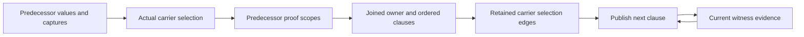

# BRA-567 active performance correction

Read this record and the work-on-bray-issues contract gate after compaction. Continue after checkpoints.
Work and pushes to feature/bra-567-async-root-orchestration are authorized. No full matrices.
This is the single current task record and computation model. Replace superseded findings.

## Acceptance contract

All five fixed formerly unfinished fixtures must take less than 500 ms for caller construction, checking and
lowering, excluding provider preparation and Rust builds. same_site_independent_second must also stay at or
below 10,000 combined condition comparisons and interner lookups, recursive work included. Count newly moved
producer, ingress and index-maintenance work too. Never meet the gate by relocating work outside measurement.

Preserve outcomes and rejection at observe(&value), source/import behavior, exact owner, dependency, current-value
and entry-snapshot scopes, qualified polarity, deterministic ordering and original budget/exhaustion behavior.
Unknowns, overwritten contents, borrowed prefixes and unavailable carriers grant nothing. Preserve authoritative
empty ownership alternatives and cleanup-feasibility rounds. Published values remain immutable. Reconstruction
is a last resort. No lock spans recursive inference. Style only at completed-batch finalization.

## Current mechanisms and evidence

ConditionIndex shares structural identity, never authority. Exact ordered fact-ID/polarity vectors own raw query
memos. Their ordered trusted/ordinary pair identifies a mixed scope. Every physical alias is retained against
address reuse. Requested, direct and closure-derived proof results remain distinct. Memos preserve original
semantic costs and exact exhausted-budget results. Proof callers use their actual trusted and ordinary inputs.

RetainedSnapshots indexes actual roots and paths. Owner queries exclude loans. Contents queries can follow
referents, but compare selected before/after contents and reject unknowns. Constructed bases are lineage, not
independently retained data. BooleanGraph shares immutable condition children. OrderedFacts preserves original
scan positions, DFS order, strictness, source precedence and budget charges. Its differential oracle covers
128 graphs and budgets 0-64. Solved flow outputs and actual cleanup parts/phases remain retained.

Current join batch groups clauses by owner and availability, and retains publication carrier-selection keys.
The same owner/source predicates and clause order remain. Only evidence is read afresh for each clause.
All 553 checker tests pass, including ordered publication with independent and unavailable carriers.
The batch adds 14 nonblank production lines and 40 test lines. Existing join tests use the grouped result.
Fixed five twice: task cases 121-130 ms, loop 169/172 ms. Extra source/import ownership controls pass at 175-183 ms.
Latest diagnostic count is 2,215,658: ordering 1,084,401, equality 548,100, identity 262,971, interning 320,186.
This batch does not materially reduce total work. Do not iterate locally on it as the route to 10,000.
Frozen30 is 29 pass and the same RawBuffer invalid acceptance, in 11.9 seconds. No full matrices ran.
Style has the same six pre-existing errors. Format and diff checks pass. There are no production probe hooks after finalization.

## Computation graph and cost model

Code tracing gives these dependencies:

- incoming_state -> propagate -> merge -> join_observations -> conditional_facts -> witness/proof queries
- transfer_block -> apply_operation -> current-value rewrites, witness refinement and retirement
- refine_witnesses -> available witnesses and pending deferred producers -> exact proof scopes
- retire_values -> retirement_dependents plus facts, clauses, allocations, private entries and selections
- final block entries -> publication operation replay -> diagnostics, effects and completion products

The inner Boolean prover already has a graph and change-driven queue. The repeated work spans its callers and
scope versions. The caller has 198 CFG blocks, two storage solves of 271 transfers, 327 raw inputs, 612 mixed
scopes, 13,032 public proof queries and 856 witness refinements. Only 12 new witness clauses result.
The structural probe finds 88 indices, 6,219 nodes, 9,633 child edges and 15,408 physical storage aliases.
Exact cross-index deduplication finds only 464 caller-observed structural nodes and 773 child edges. Of these,
446 are first encountered during the caller. The whole measured process registers 988 distinct indexed nodes.
This uses exact root payloads plus global child IDs, with hash collisions checked. Probe bookkeeping is excluded
from compiler counters. It observes indexed nodes, not every transient condition constructed outside an index.
The bounded source loop still rejects at the intended observe call. Production is c407abd16. This measurement
supports producer-owned handles but does not prove that handles alone reach the gate.
Outer lookup repetition includes scope preparation 21,318 requests/91 distinct nodes, proof 65,414/587,
refinement 21,682/153 and retirement 120,098/2,536. Distinct means index plus node, not evidence scope.
Retirement has 92,546 pure-cache hits and 27,552 misses. It removes 142/1,864 ordinary facts, 276/716 trusted
facts and 1,148/2,604 witness clauses. Many changes are real. Broad retirement skipping is unsound.

Minimize construction and maintenance plus sum(evaluation count * exclusive evaluation cost), with bounded
memory and the acceptance constraints above. Inclusive profile stages overlap and must not be summed.
Eliminating recursive comparisons below the root saves at most about 13 percent. Eliminating caller publication
replay saves at most about 23 percent before replacement costs. The target requires over 99.5 percent overall.
No existing measurement proves a 10,000 solution or an optimal representation.

The join detail distinguishes fixed selection edges from changing evidence:

Publication keeps the ordered evidence cycle. It cannot change current values or deferred inputs. A newly
inserted owner is an explicit potential endpoint, initially absent. Earlier owners' insertions are visible
when selecting the next owner. A parent with unknown contents does not retain invented child authority.
The current batch removes repeated discovery at this boundary, under 60 net production lines. The broader
replacement must remove repeated computation across versions, not add another cache or eager traversal.

## Typed dependency inventory

The graph is a hypergraph because several inputs can be required together. The following edges came from
parallel read-only source scans and parent inspection. They are semantic dependencies, not authority grants.

| Producer/consumer | Required edges and invalidation rules |
| --- | --- |
| Condition nodes and traversal | Distinguish data, owner, component, operand, live borrow, selector, descriptor and capture roles. Captured entries and descriptors are traversal barriers for some consumers. Live traversal keys include the live/nonlive role. Structural children alone are insufficient. |
| CurrentValues | Place -> current value, availability, ancestors/components and explicit descendant absence. Writes and retirement publish new bindings. Old terminal contents can remain readable without live authority. |
| Joins | Separate value and owner substitutions. Actual predecessor snapshots are not their general inverse. Complete snapshots, nested active-case guards and reached reference data remain separate. Conflicting source mappings become Unknown. Per-value and combined collectors have different original budgets. |
| Witness refinement | Each clause proof, including None, contributes to the whole proved-evidence set. That set plus ordinary facts determines guard discharge. Preserve carrier availability, owning bit, address-owner payload and original witness/producer order. Availability alone is not clause truth. |
| Carrier retirement | Carrier -> ordered captured ancestors, actual owned components and dependency places. Retained owners cut ancestor paths. Place -> current value -> observed paths applies to nonwrites. Match ancestor/descendant overlap, exclude siblings, and never infer ownership from equal contents. |
| Clause revocation | Clause -> address -> owner place -> current observation is distinct from carrier lifetime. Writes, retirement, raw referent mutation, root expiry and cleanup have different policies. Keep private-admission exceptions and all independent live supports for qualified facts. |
| Deferred evidence | Key by owner, execution site and captured entry. Retain owned arguments, extracted evidence and report snapshots. Selection/copy origins can expire while captured arguments remain. Possibility depends on absence of proved opposite guards. Captured ordinary facts grant no public authority. |
| Proof queries | Include exact and absent membership/complement probes, relational subjects, variants, ordered-path frontiers, alternatives and alias hypotheses. Changed hypotheses reset their results. Removed supports require rederivation, including conflicts and multiple independent supports. |
| Proof budgets | Preserve trusted-before-ordinary precedence, ordered DFS and Boolean short circuits. Fact rank and total length affect exhaustion even when truth is unchanged. Retain exact partial answers for incoming limits. Successful premises alone never justify reuse. |
| Substitution | Include failed exact hits and longer-prefix misses, replacement priority, value/owner role and capture barriers. Ordered children share one decreasing budget. Inserted snapshots are not recursively expanded. |
| Cleanup/publication | Cleanup uses retained owner, stable observations and proved truth. Private evidence needs the exact admitted carrier and entry scope. Final publication still needs intermediate checks, diagnostic deduplication, cancellation and completion products. Final block output alone is insufficient. |

Source owners are execution_guarantees/{condition,boolean,trusted_implication,ordered_facts,witness,evidence},
analysis/guarantee/{state,current,deferred,retirement,trusted/carriers,flow/merge,flow/witnesses}, and storage_flow.
Do not flatten these edges into a generic changed-owner test or cache resolved current values as immutable.

## Representation direction and remaining design questions

Repeated alias conversion itself exceeds the count target. Carry immutable node handles and structural IDs
from producers through proofs, graphs, rewrites and fact memberships. One ExecutionConditionKind schema should
replace the recursive public enum plus duplicate child-ID/alias indexing. Remove StorageKey/StorageLookup and
per-query interning after migration. Retain structural order, never numeric ID or allocation order, for facts,
budget precedence, serialization and diagnostics. Owner identity and proof authority stay separate from nodes.

Prefer a factory owned by CompilationState, reachable through CheckerRequestContext and binding contexts.
Both provider/input producers and body analysis can use it without per-body reconstruction or a crate cycle.
Nodes must survive the factory through immutable ownership without a factory->node->factory cycle. Construct
children before taking a short insertion lock. Factory calls, ingress and maintenance still count. Constant
nodes can be retained directly. A compilation-wide strong table retaining transient nodes needs a memory bound.

Related compilation snapshots can share a weak structural interner. Preserve today's exact structural equality,
including raw local IDs. Equal shapes may share allocation because context-dependent facts and authority remain
outside nodes. No copied interner maps, new snapshot namespaces or routine body imports are needed. Reused
execution candidates keep their original handles. Portable package terms decode directly into destination nodes.
Weak buckets must not retain children through strong keys, and dead buckets need amortized reclamation. Keep
structural ordering for budget-sensitive iteration. Node IDs and addresses never define ordering or serialization.

Physical-sharing traversals mostly compute existential properties or sets. One unresolved consumer is bounds.rs:
its observation iterator calls a prover sharing IntegerRanges. Partial range computations can warm later queries
without charging their original cost. The selector precheck may prevent the proposed retry scenario. This is a
code-derived risk, not a demonstrated source failure. Resolve it before canonical sharing changes visit multiplicity.

The fixed-point graph retains block outputs but repeats incoming edge transformations before comparing joined
inputs. Each edge refines witnesses, and applicable pattern refinements can trigger another pass. The two storage
solves are required cleanup-feasibility rounds. The 856 witness computations are exact-scope cache misses, not
all calls. A scheduling replacement must retain failed obligations and ordered publication dependencies as well
as successful proofs. Reducing scan calls alone does not establish the operation-count gate.

The existing exhaustive hash_parts child emitter can supply semantic slots/roles while hashing. Migrate duplicate
traversal matches to that schema, not to a second manually maintained mirror. Node-local checks and traversal
barriers remain explicit. A witness collection and CurrentValues must own their published dependency relations.
Do not maintain a shadow reverse index by hand at mutation sites. Persistent ordered fact versions also need
rank/length accounting, failed-query dependencies and independent supports before selective recomputation is safe.
These contracts are not all closed. Do not start a speculative semantic rewrite or claim a complete model yet.

Do not repeat eager retirement fusion, witness allocation-key caches, unchanged-carrier shortcuts or empty-
invalidation shortcuts. Keep the fixed five, source/import ownership controls, checker suite and frozen30 fixed.

## Fixed evidence and broader work

Use optimized tooling, shared target/cargo and pinned target/toolchains/llvm/active. Select products from a
successful proof-build.jsonl. Native runs stay outside the sandbox. Fixed cases are bounded to 10 seconds.
proof-unfinished.json freezes five identities. correction-frozen30.json freezes membership and correction-current.json
maps names. Fixed 920 is comparison.txt plus verification.json additions. Keep one current count, timing and
regression result plus one probe patch. Remove hooks and stale raw outputs after verification. Build without
hooks for final goal evidence, not every checkpoint. Retain the checker-only non-incremental override. Never
clean shared Cargo storage. Do not run full matrices under the current scope.

BRA-567 still needs generic borrowed-field completion mappings, inactive conditional result shapes and RawBuffer
payload dependencies. Keep d302124's deferred-admission control. Then finish maintainability, owned/deferred
matrices, frozen30, fixed920 and source/native gates. Verify root/main authority, cleanup before terminal
publication, normal/panic/cancellation, rollback once, services through static disposal, synchronous control and
native archive/link removal of Rust orchestration. Independent draft-PR review precedes ready/In Review. Close
only after merge. Six existing style errors remain: wildcard flow/invalidation and oversized flow/merge,
storage_flow cleanup/core, execution_guarantees/portable and tooling output/diagnostic/json/argument.
