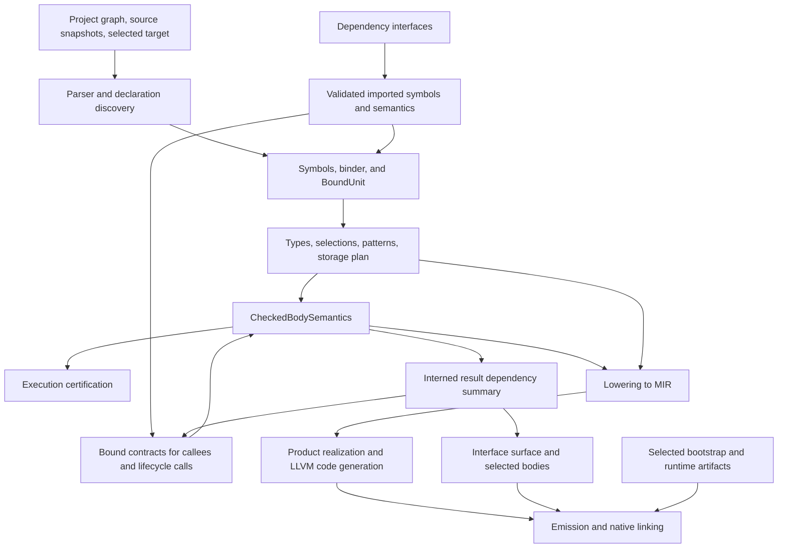
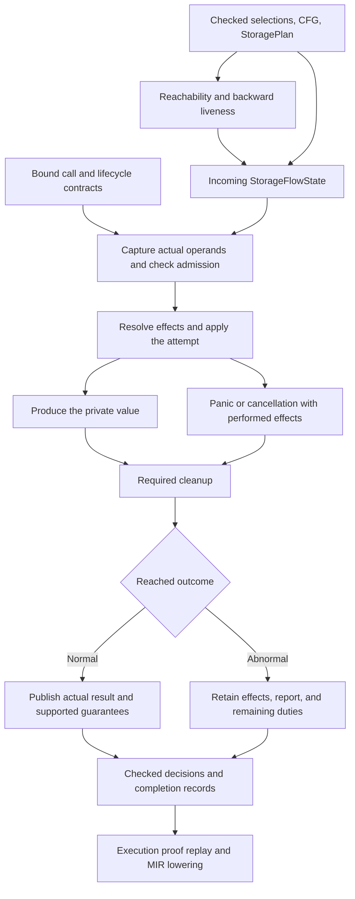

# Bray compiler architecture for BRA-694

This map follows the compiler from source and package inputs to checked bodies, imported contracts, MIR, and native
products. It expands the storage, proof, cleanup, and runtime paths involved in the refactor. It includes the
guarded outcomes under development after `63b675072`. The [refactor record](bra-694-native-bootstrap.md) holds the agreed scope and verification
results. The [compiler design](../design/compiler-architecture.md) and [crate responsibilities](../contributing/crates.md)
describe the wider architecture.

## Compiler and product queries

- **Source and package selection.** `bray-project` owns the package-product graph. Compilation selects sources, import
  inputs, and target settings. Parsing supplies immutable syntax to declaration discovery. The symbol snapshot and binder
  give the selected source body a `BoundUnitKey` and source-correlated HIR. Imported signatures and relationships join
  the same symbol and semantic-value system. [Compilation construction](../../crates/bray-compilation/src/compilation/state/construction.rs)
  · [Bound-unit query](../../crates/bray-compilation/src/compilation/unit/query/evaluation.rs)
- **Semantic queries.** Type checking and call or operator selection establish declarations, receiver conventions,
  substitutions, implementations, witnesses, and conversions. Pattern checking, memory-operation checking, storage
  planning, and prepared body analysis use those selections. The fact cache shares immutable publications and records
  dependencies under the owning query. A body prerequisite can change without changing its declaration identity.
  [Body query inputs](../../crates/bray-compilation/src/compilation/unit/storage.rs)
  · [Fact cache](../../crates/bray-compilation/src/fact/cache.rs)
- **Body and summary.** For source callables, anonymous bodies, and source runtime defaults, the demanded result-dependency
  component supplies both the checked body and its summary. Recursive members use the current interned approximations of
  members of their strongly connected component. The component settles those approximations before publication. The arrow
  from summaries to bound contracts represents a caller reading its callees' contracts. Imported summaries and checked
  leaf contracts enter through the same callable result-dependency query.
  [Result dependency component](../../crates/bray-compilation/src/compilation/binder/symbol/result_dependencies.rs)
- **Downstream queries.** `execution_properties` uses the checked body, prepared graph, and certified dependencies to
  check execution promises. Its proof flow can replay the body's checked storage records. `lowered_unit` assembles
  checked inputs for `bray-lowering`, which builds MIR. Compilation collects structured diagnostics from the prerequisites
  and returns no lowered unit on errors. `bray-messages` renders diagnostic text.
  [Execution certification query](../../crates/bray-compilation/src/compilation/execution_guarantees/query.rs)
  · [Lowering query](../../crates/bray-compilation/src/compilation/lowering/query.rs)
- **Products and runtime.** Product realization selects concrete instances and ABI mappings. LLVM translates and verifies
  MIR, including generated host, callback, and async bodies. `bray-emitter` stages outputs and `bray-linker` links selected
  objects and runtime artifacts. `bray-runtime-interface` describes compiler-facing roles and compatibility, while
  `bray-runtime-abi` defines the native records and symbols. The bootstrap package supplies production Bray bodies.
  Rust runtime adapters expose the stable ABI of their selected components. [Product emission](../../crates/bray-compilation/src/compilation/product_emission/execution.rs)
  · [LLVM design](../design/codegen.md) · [Runtime integration](../design/async-runtime.md)

## Data owners and identities

| Concept | Producer and storage | Meaning at the next boundary |
| --- | --- | --- |
| Operation, slot, and route | The checker produces `StoragePlan` and the CFG. `BoundExecutionSite` identifies the source operation or implicit call. `StorageIdentityId` and the path within it identify planned storage. | `StorageReferencePath` combines inline projections with typed `Read` and `Backing` steps. Liveness uses structural uses and definitions. Forward analysis resolves reads against actual state. |
| Current value and availability | `ExecutionState.current` holds one `CurrentValues` tree per root. Evaluation and assignment change the tree. An `ExecutionCondition` can carry both logical data and `StorageCapturedValue`. | Availability and contents are separate. A moved value can retain its terminal data while its old slot has ceased to supply ownership. A capture can survive replacement of its source slot. |
| Descriptor and possible regions | The physical memory state holds `StorageValueBinding` per target. `StorageAddressValue` distinguishes actual alternatives, region bounds, displaced offsets, and unknown addresses. Whole-value dependency bounds have their own completeness. | A finite region bounds what may change. An exact write, initialized payload, or ownership transfer needs separate evidence. Inactive payload, actual null, and unknown contents each have a distinct meaning. |
| Allocation and access authority | Physical state tracks reached `StorageTarget` origins, initialization, and borrow capabilities. Allocation recency distinguishes a current allocation from older objects formed at the same site. | Pointer equality can establish data equality. Lifetime, initialized contents, access permission, and the cleanup duty each come from their own checked relation. |
| Mutation and observation survival | `StorageMutationTarget` holds the resolved address and conservative footprint. Effect kind and access type accompany it. The storage collector publishes observation invalidations and phase-specific retirements. | Descriptor replacement, pointee writes, atomic payload updates, consumption, and retirement have different consequences. A broad footprint can revoke support without establishing an exact layout or initialized write. |
| Witness and report support | `ExecutionState` has ordinary facts, trusted facts, a witness ledger, and allocation-owner relations. Result dependency state tracks report values and their retained storage dependencies. | A witness belongs to a particular owner and can depend on contents, a descriptor, or a reached lifetime. A report has its own ownership and may outlive a scope. An independent report is still a report. |
| Portable identity | `DependencySubject` and captured terms name formal entry values, results, captures, and statics. Packages remap those identities through checked interface records. Unary signs use the scalar term encoder. Binary captured storage arithmetic retains both evaluated operands. | Receiver-first argument ordinals, result selectors, and selected root, product-static, and thread-static identities must retain their distinct meanings after substitution and import. Scalar arithmetic supplies no ownership evidence. |

Data definitions and producers. [Storage plan](../../crates/bray-bound-tree/src/storage/plan/model.rs)
· [Typed routes](../../crates/bray-bound-tree/src/storage/reference.rs)
· [Current values](../../crates/bray-checker/src/analysis/guarantee/current.rs)
· [Physical state](../../crates/bray-checker/src/analysis/storage_flow/memory/model.rs)
· [Value binding and target precision](../../crates/bray-bound-tree/src/storage/value.rs)
· [Proof state and retirement](../../crates/bray-checker/src/analysis/guarantee/retirement.rs)

## Composite flow from admission to publication

The diagram shows the semantic order across calls, result regions, and cleanup. Each has its own CFG operations.
Ordinary and implicit calls use `Input`, `Attempt`, and `Completion`. Result regions use `Begin`, `Production`, and
`Completion`. Yield or break transfers can install the private value. Suspension and scope exit have separate
operations. [CFG operation kinds and phases](../../crates/bray-checker/src/analysis/model.rs)
· [Result region construction](../../crates/bray-checker/src/analysis/result.rs)
· [Call and await construction](../../crates/bray-checker/src/analysis/execution.rs)

| Boundary | What the implementation passes forward |
| --- | --- |
| Prepare and solve | `check_body_semantics` prepares refinements and call contracts, computes reachable edges and backward liveness, then solves forward `StorageFlowState` and checks async plans. If the async result rules out cleanup edges, it recomputes liveness and flow with fewer edges. `StorageFlowState` keeps logical proof, physical memory, moves, borrows, effects, and report dependencies together. [Body checking](../../crates/bray-checker/src/body_semantics.rs) · [Flow domain](../../crates/bray-checker/src/analysis/storage_flow/model/domain.rs) |
| Evaluation and admission | `resolve_value_captures` and `capture_entry_values` retain the evaluated input, any typed current referent, and possible element dependencies. `ExecutionCallEvidence` holds these actual arguments, entry facts, admitted carriers, extracted values, and bound outputs. The checked phase determines when ownership is consumed. A false entry requirement can fail before the body runs. [Physical capture](../../crates/bray-checker/src/analysis/storage_flow/check/analysis/references/captured.rs) · [Entry evidence](../../crates/bray-checker/src/execution_guarantees/evidence.rs) |
| Attempt and invalidation | `apply_operation_effects` binds value rows and resolves selected call, intrinsic, and assignment effects. The physical memory update and proof invalidation consume the resolved observations. Failure effects capture addresses before argument transfer. Execution retirements reach the proof state before completion. Last-use and consumed-handle retirements follow publication. [Operation driver](../../crates/bray-checker/src/analysis/storage_flow/check/analysis/core.rs) · [Effect binding](../../crates/bray-checker/src/analysis/storage_flow/check/analysis/effects.rs) · [Proof invalidation](../../crates/bray-checker/src/analysis/guarantee/flow/invalidation.rs) |
| Private result and cleanup | The private result can be present while caller publication is pending. Scope exit selects active obligations, including cancellation broadcast and lifecycle resolution. Lifecycle invocation uses the resolved receiver and its checked contract. Cleanup can change contents, retire support, retain dependencies for a report, or take an abnormal edge. [Private result](../../crates/bray-checker/src/analysis/guarantee/flow/value.rs) · [Storage cleanup](../../crates/bray-checker/src/analysis/storage_flow/check/analysis/cleanup.rs) · [Lifecycle transition](../../crates/bray-checker/src/analysis/guarantee/cleanup/transition.rs) |
| Normal completion | `complete_entry_outputs` selects feasible value rows and completes ownership and carriers against the actual result. `publish_captured_outputs` pairs the surviving logical value with its physical snapshot and records it for replay. Exact current destinations and possible region writes have different publication paths. `StorageFlow` also publishes reachability, storage decisions, replacements, suspension, and scope exits. [Output binding](../../crates/bray-checker/src/analysis/guarantee/flow/captured.rs) · [Completion and carriers](../../crates/bray-checker/src/analysis/guarantee/trusted/completion.rs) · [Checked storage flow](../../crates/bray-bound-tree/src/storage/flow/model.rs) |
| Failure, catch, and cancellation | Failure edges apply captured prefix effects. Result dependency analysis carries report equations through catch boundaries and closes them at exits. The current contract keeps abnormal reports separately, and failure binding can use the all-path effect envelope. A failure edge supplies no normal result. Cancellation after a child completes can own that child's already transferred result and require its cleanup. [Failure propagation](../../crates/bray-checker/src/analysis/storage_flow/model/domain.rs) · [Report ownership](../../crates/bray-checker/src/analysis/storage_flow/check/analysis/reports.rs) · [Await edges](../../crates/bray-checker/src/analysis/execution.rs) |
| Deferred execution | Formation captures the selected callable, receiver type, witnesses, evaluated arguments, and owned inputs. Start and direct await refresh reached contents while retaining the captured address descriptors. `StorageDeferredTransition` keeps latent effects, guarded normal rows, typed failure prefixes, and cleanup. Scheduling accounts for possible interference. Observation selects the task's performed effects from its captured frame, then publishes its actual result and any acquired report. An outer failure while suspended has its own admitted state and possible performed prefix. [Deferred proof flow](../../crates/bray-checker/src/analysis/guarantee/flow/deferred.rs) · [Deferred physical effects](../../crates/bray-checker/src/analysis/storage_flow/check/analysis/deferred.rs) · [Captured transition](../../crates/bray-bound-tree/src/storage/capture/transfer.rs) |
| Replay and lowering | Certification uses checked input targets, invalidation, completions, and retirement events during proof replay. Lowering uses checked targets, moves, activity decisions, scope exits, suspensions, and completion presence to emit MIR. MIR carries explicit initialization guards, result and report transfers, cancellation, and cleanup edges to code generation. [Proof replay](../../crates/bray-checker/src/analysis/guarantee/flow/operation.rs) · [Lowerer](../../crates/bray-lowering/src/lowering/lowerer.rs) · [MIR cleanup](../../crates/bray-lowering/src/lowering/cleanup/control.rs) |

### Joins and loops

The existing fixed-point solver schedules blocks and edges. Edge propagation refines feasible paths, applies failure
effects when appropriate, transfers report ownership, and ends lifetimes before the merge. At a merge, may-effects and
possible dependencies grow. Definite initialization and unconditional proof require agreement on all covered paths.
Availability, tag tests, and ordinary predecessor facts can guard more precise observations. Logical joins use stable
block, expression, and place identities. Physical merges combine targets and contents separately and require both
temporary evaluation storage and queued retirements to have been processed. A new loop iteration can retire a prior
evaluation at the same source site. Edges carrying explicit yielded or broken results and selected call rows can retain
distinct composite states through these joins. Loop headers and the finite alternative budget use the existing
conservative merge. The publication pass applies the same transitions to the reached states.
[Worklist](../../crates/bray-checker/src/analysis/fixed_point.rs)
· [Guarded composite states](../../crates/bray-checker/src/analysis/storage_flow/model/outcomes.rs)
· [Composite merge](../../crates/bray-checker/src/analysis/storage_flow/model/state.rs)
· [Logical joins](../../crates/bray-checker/src/analysis/guarantee/flow/merge.rs)
· [Value join](../../crates/bray-checker/src/execution_guarantees/snapshot.rs)

## Summary, import, and call binding

1. At a reached normal exit after cleanup, `collect_completion` reads the actual result and physical references, observes
   proved postconditions, and collects the effect prefix and report dependencies. The summary builder packages those
   observations with the guard, captured value graph, ownership layout, inactive payloads, and witness carriers in
   `CapturedValueOutcome`. `CapturedValueTemplate` retains portable inputs and operations with explicit unknown nodes.
   Reached failures capture their performed prefix and report dependencies in `CapturedFailureOutcome`. A known empty
   prefix and an opaque prefix have distinct representations.
   [Exit producer](../../crates/bray-checker/src/analysis/storage_flow/check/analysis/core.rs)
   · [Normal summary rows](../../crates/bray-checker/src/analysis/storage_flow/check/analysis/references/publication.rs)
   · [Portable model](../../crates/bray-symbols/src/value/captured.rs)
2. The source component combines observations across recursive rounds. Generic substitution remaps the same portable
   graph. Package export maps it to interface symbol, type, term, and projection identities. Revision 10 encodes capture
   graphs, normal and failed outcomes, deferred callees, and carrier support. Decode, selected record remapping, validation, and interning map
   those identities in the importing semantic store. Revision 11 preserves the distinction between panic and cancellation.
   Specialization identity also depends on the portable contract.
   [Substitution](../../crates/bray-symbols/src/value/substitution_apply/dependency.rs)
   · [Export conversion](../../crates/bray-compilation/src/compilation/export/semantic/dependencies.rs)
   · [Capture codec](../../crates/bray-package-interface/src/semantic/codec/captured.rs)
   · [Validation](../../crates/bray-package-interface/src/semantic/validation/captured.rs)
   · [Imported interning](../../crates/bray-package-interface/src/semantic/interning/dependency.rs)
   · [Specialization identity](../../crates/bray-compilation/src/compilation/product/specialization_identity/dependency.rs)
3. Source and imported `CallableResultDependenciesQuery` results feed the same checked call contract. `BoundCallStorage`
   supplies typed subject and endpoint routes. At admission, the instantiator binds entry guards and destinations against
   the evaluated input. Completion binds residual result guards against the produced result. `ExecutionOutputs` keeps
   portable row indices so physical references, effects, reports, and logical publications can share admission.
   [Imported result query](../../crates/bray-compilation/src/compilation/binder/symbol/imported.rs)
   · [Call instantiation](../../crates/bray-checker/src/dependency/call/contract.rs)
   · [Bound routes](../../crates/bray-bound-tree/src/dependency_table/storage.rs)
   · [Output rows](../../crates/bray-checker/src/execution_guarantees/outputs.rs)

Ordinary call attempts can carry one selected row through physical effects, private production, and publication.
Their failure edge uses the admitted state and captured failure prefix. Deferred observation uses the same
composite flow for selected frame identities and completed or abnormal alternatives. The flow retains the
captured inputs, actual payload, effect prefix, and reports until variant refinement. Bounded widening still
joins the alternatives conservatively. Lifecycle cleanup and execution replay still have paths that join before
all consumers read a selected outcome. Explicit declared guarantees still use prepared observation and address
bindings beside the inferred carrier path.
[Physical call references](../../crates/bray-checker/src/analysis/storage_flow/check/analysis/references/transfer.rs)
· [Explicit guarantee binding](../../crates/bray-checker/src/analysis/guarantee/trusted/dependencies.rs)

Direct calls and awaits carry the panic or cancellation identity on separate abnormal edges. Storage flow applies the
matching performed prefix to the admitted pre-normal state. Proof replay uses the published invalidation and capture
retirements for that same edge. Report retention uses the admitted failure rows for the edge's kind, and summary
export retains that kind. `RunResult.Cancelled` is payload-free. On a terminal cancellation, the host owns its cleanup
incidents. A cleanup panic can instead transfer them with a `PanicReport`.
[Invocation and await CFG](../../crates/bray-checker/src/analysis/execution.rs)
· [Dependency failure CFG](../../crates/bray-checker/src/analysis/cleanup.rs)
· [Failure application](../../crates/bray-checker/src/analysis/storage_flow/model/domain.rs)
· [Cancellation and incidents](../language/async-and-concurrency/cancellation.md)

The first cleanup failure can occur after other lifecycle steps have completed. The
storage schedule owns the acquired values and cleanup order. The invocation owns
its selected effect prefix and report. The enclosing exit owns the primary reason
and already retained incidents. The current CFG forks before the scope's work and
uses one `CleanupRequired` edge for both panic and cancellation. Replay then
reads one mutation record per occurrence, access, part and slot. Replacing this
fork requires the checked transition and its replay consumers to retain the same
reached invocation, performed prefix and remaining suffix. Lowering must keep the
same cancellation broadcast, shielding and primary-report precedence.
[Scope exit assembly](../../crates/bray-checker/src/analysis/assembly.rs)
· [Lifecycle transition and replay](../../crates/bray-checker/src/analysis/guarantee/cleanup/transition.rs)
· [Mutation identities](../../crates/bray-bound-tree/src/storage/observation.rs)

## Cross-layer compositions

| Composition | End-to-end relationship |
| --- | --- |
| Generic value, buffer, frame, and escape | A value containing a reference moves into generic `RawBuffer<T>` storage. The captured graph represents the initialized prefix, including the whole value appended or popped. Branches and loops affect which prefix and owning transfer survive. Moving the buffer into a deferred frame transfers element dependencies and cleanup. Pop moves the selected value out and leaves the remaining dependencies with the buffer. Scope exit or escape checks referent lifetimes against the actual surviving owner. The same row and relationships must cross a package interface. [Buffer source](../../standard-library/std/src/memory/buffer.bray) · [Checked buffer operations](../../crates/bray-checker/src/analysis/storage_flow/check/analysis/memory/buffer.rs) |
| Saved pointer and retirement | Selecting a field, reading its descriptor, and following it are separate operations. A later write to the field changes the current descriptor. Retirement through the earlier evaluated value applies to that reached allocation and revokes its dependent witnesses. The effect footprint bounds conservative invalidation. It does not name the allocation to dispose. [Typed route execution](../../crates/bray-checker/src/analysis/storage_flow/memory/references/route.rs) · [Effect resolution](../../crates/bray-checker/src/analysis/storage_flow/check/analysis/effects.rs) |
| Native dispatch and start | `dispatch_ready` holds `Current` and its acquisition while retaining a resident task reference. The historical error is at `context(selected)` after `record_task_failure`. `start_frame` holds a prepared owner across task registration and lane demand, then calls `commit_start`. Relating either failure to retirement needs the reached allocation, the retained acquisition, the task slot, and any callback or cleanup owner at that phase. The historical diagnostics establish where proof was required. [Dispatch](../../runtime/bootstrap/src/execution/driving.bray) · [Current and context](../../runtime/bootstrap/src/execution/context.bray) · [Task failure](../../runtime/bootstrap/src/execution/failure.bray) · [Start](../../runtime/bootstrap/src/execution/start.bray) · [Registration](../../runtime/bootstrap/src/execution/scheduling.bray) · [Commit](../../runtime/bootstrap/src/execution/prepared_start.bray) |
| Windows environment read | `native_environment_entry` produces the Boolean and span together and declares initialized-read guarantees under the true result selector. `environment_storage` selects the true branch and passes the actual address field to `byte_buffer_read`. The source returns distinct tuples. Loss can occur after result production, during guarantee instantiation, publication, branch refinement, or proof retention. [Windows implementation](../../standard-library/std/src/platform/windows.bray) · [Production check and lowering](../../crates/bray-compilation/src/compilation/trusted_contracts/contract_tests/standard_storage.rs) |
| Scoped unit completion | Scope enter, body, and exit can complete with a unit result and no recorded observations. The collector publishes a completion for a reached normal phase even when its payload is empty. `invocation_completes` uses that record in lowering to preserve the following return. [Completion collection](../../crates/bray-checker/src/analysis/storage_flow/check/analysis/core.rs) · [Lowering consumer](../../crates/bray-lowering/src/lowering/expression/core/operations.rs) · [Scoped result control](../../crates/bray-compilation/src/compilation/lowering/tests/lifecycle.rs) |
| Deferred task observation | `start` holds the selected body's evaluated inputs. The completed `join` or `cancel` outcome produces the body's value and resumes its witnesses. The abnormal outcome has its own prefix and cannot use that value. `try` selects `Completed` before transferring the payload. [Deferred frame and logical completion](../../crates/bray-checker/src/analysis/guarantee/flow/deferred.rs) · [Composite outcome propagation](../../crates/bray-checker/src/analysis/storage_flow/model/outcomes.rs) · [Source and imported controls](../../crates/bray-compilation/src/compilation/export/build/tests/deferred_completion.rs) |

The generic join trace and Windows environment trace identify different points in this map. The generic trace records
actual active and inactive payloads before a join replaces them with a common value. The Windows trace still has the
distinct actual tuples when the call completes. The scoped unit trace records a reached phase whose empty payload is
discarded. These observations leave the two historical bootstrap failures open.

The checked-in bootstrap proof entry points currently select x86-64 Linux and Windows. They request both
`execution_properties` and `lowered_unit` for each listed body. The agreed gate also requires the AArch64 targets and the
1714-case frozen comparison on the same candidate. Four removed comparison identities still need native replacements.
[Bootstrap proof entry points](../../crates/bray-compilation/src/compilation/trusted_contracts/contract_tests/bootstrap.rs)
· [Native target definitions](../../crates/bray-target/src/native.rs)
