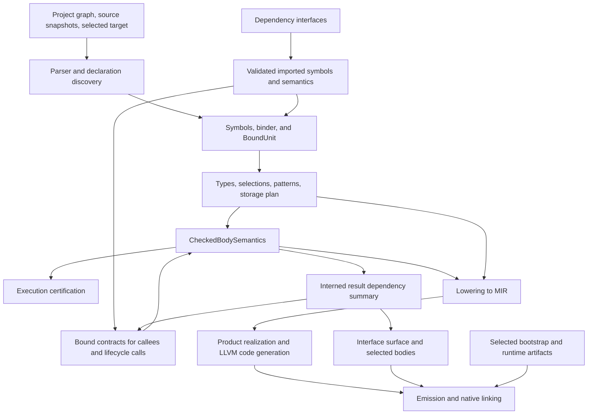
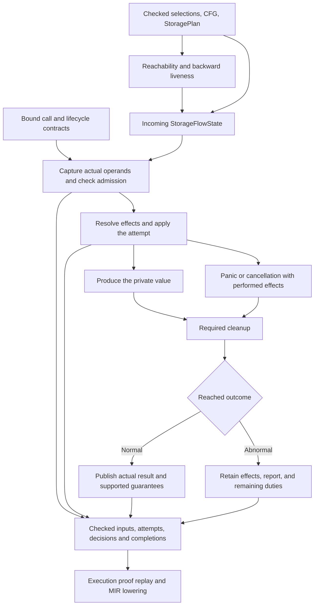

# Bray compiler architecture for BRA-694

This map follows the compiler from source and package inputs to checked bodies, imported contracts, MIR, and native
products. The [refactor record](bra-694-native-bootstrap.md) holds the agreed scope and verification results.
The [compiler design](../design/compiler-architecture.md) and [crate responsibilities](../contributing/crates.md)
describe the wider architecture.

## Compiler and product queries

- **Source and package selection.** `bray-project` owns the package-product graph. Compilation selects sources, import
  inputs, and target settings. Parsing supplies immutable syntax to declaration discovery. The symbol snapshot and binder
  give the selected source body a `BoundUnitKey` and source-correlated HIR. Imported signatures and relationships join
  the same symbol and semantic-value system. [Compilation construction](../../crates/bray-compilation/src/compilation/state/construction.rs)
  · [Bound-unit query](../../crates/bray-compilation/src/compilation/unit/query/evaluation.rs)
- **Semantic queries.** Type checking and call or operator selection establish declarations, receiver conventions,
  substitutions, implementations, witnesses, and conversions. Pattern checking, memory-operation checking, storage
  planning, and prepared body analysis use those selections. The fact cache shares immutable publications and records
  dependencies under the owning query. A body prerequisite can change without changing its declaration identity.
  [Body query inputs](../../crates/bray-compilation/src/compilation/unit/storage.rs)
  · [Fact cache](../../crates/bray-compilation/src/fact/cache.rs)
- **Body and summary.** For source callables, anonymous bodies, and source runtime defaults, the demanded result-dependency
  component supplies both the checked body and its summary. Recursive members use the current interned approximations of
  members of their strongly connected component. The component settles those approximations before publication. The arrow
  from summaries to bound contracts represents a caller reading its callees' contracts. Imported summaries and checked
  leaf contracts enter through the same callable result-dependency query.
  [Result dependency component](../../crates/bray-compilation/src/compilation/binder/symbol/result_dependencies.rs)
- **Downstream queries.** `execution_properties` uses the checked body, prepared graph, and certified dependencies to
  check execution promises. Its proof flow applies the body's checked storage records. A candidate query shares the
  solved flow across obligations with the same entry assumptions and enabled edges. Each obligation records its own
  dependencies and diagnostics. `lowered_unit` assembles
  checked inputs for `bray-lowering`, which builds MIR. Compilation collects structured diagnostics from the prerequisites
  and returns no lowered unit on errors. `bray-messages` renders diagnostic text.
  [Execution certification query](../../crates/bray-compilation/src/compilation/execution_guarantees/query.rs)
  · [Lowering query](../../crates/bray-compilation/src/compilation/lowering/query.rs)
- **Products and runtime.** Product realization selects concrete instances and ABI mappings. LLVM translates and verifies
  MIR, including generated host, callback, and async bodies. `bray-emitter` stages outputs and `bray-linker` links selected
  objects and runtime artifacts. `bray-runtime-interface` describes compiler-facing roles and compatibility, while
  `bray-runtime-abi` defines the native records and symbols. The bootstrap package supplies production Bray bodies.
  Rust runtime adapters expose the stable ABI of their selected components. [Product emission](../../crates/bray-compilation/src/compilation/product_emission/execution.rs)
  · [LLVM design](../design/codegen.md) · [Runtime integration](../design/async-runtime.md)

## Data owners and identities

| Concept | Producer and storage | Meaning at the next boundary |
| --- | --- | --- |
| Operation, slot, and route | The checker produces `StoragePlan` and the CFG. `BoundExecutionSite` identifies the source operation or implicit call. `AnalysisOperationId` identifies an exact CFG operation, including each copy of a scoped exit. `StorageIdentityId` and the path within it identify planned storage. | `StorageReferencePath` combines inline projections with typed `Read` and `Backing` steps. Liveness uses structural uses and definitions. Forward analysis resolves reads against actual state. |
| Current value and availability | `ExecutionState.current` holds one `CurrentValues` tree per root. Evaluation and assignment change the tree. An `ExecutionCondition` can carry both logical data and `StorageCapturedValue`. | Availability and contents are separate. A moved value can retain its terminal data while its old slot has ceased to supply ownership. A capture can survive replacement of its source slot. |
| Descriptor and possible regions | The physical memory state holds `StorageValueBinding` per target. `StorageAddressValue` distinguishes actual alternatives, region bounds, displaced offsets, and unknown addresses. Whole-value dependency bounds have their own completeness. | A finite region bounds what may change. An exact write, initialized payload, or ownership transfer needs separate evidence. Inactive payload, actual null, and unknown contents each have a distinct meaning. |
| Allocation and access authority | Physical state tracks reached `StorageTarget` origins, initialization, and borrow capabilities. Allocation recency distinguishes a current allocation from older objects formed at the same site. | Pointer equality can establish data equality. Lifetime, initialized contents, access permission, and the cleanup duty each come from their own checked relation. |
| Mutation and observation survival | `StorageMutationTarget` holds the resolved address and conservative footprint. Effect kind and access type accompany it. The storage collector publishes observation invalidations and phase-specific retirements. | Descriptor replacement, pointee writes, atomic payload updates, consumption, and retirement have different consequences. A route through an explicitly inactive payload contributes no target. A broad footprint can revoke support without establishing an exact layout or initialized write. |
| Raw retirement | The raw pointer or the allocation record's pointer field comes from the admitted argument capture. Each retirement records its preceding typed duty discharges. | Effect binding, lifetime invalidation, and outstanding-duty diagnostics use that operand. A guarded outcome publishes exact cell changes after its performed effects. |
| Witness and report support | `ExecutionState` has ordinary facts, trusted facts, a witness ledger, and allocation-owner relations. Result dependency state tracks report values and their retained storage dependencies. | A witness belongs to a particular owner and can depend on contents, a descriptor, or a reached lifetime. A report has its own ownership and may outlive a scope. An independent report is still a report. |
| Portable identity | `DependencySubject` and captured terms name formal entry values, results, captures, and statics. Packages remap those identities through checked interface records. Unary signs use the scalar term encoder. Binary captured storage arithmetic retains both evaluated operands. | Receiver-first argument ordinals, result selectors, and selected root, product-static, and thread-static identities must retain their distinct meanings after substitution and import. Scalar arithmetic supplies no ownership evidence. |

Data definitions and producers. [Storage plan](../../crates/bray-bound-tree/src/storage/plan/model.rs)
· [Typed routes](../../crates/bray-bound-tree/src/storage/reference.rs)
· [Current values](../../crates/bray-checker/src/analysis/guarantee/current.rs)
· [Physical state](../../crates/bray-checker/src/analysis/storage_flow/memory/model.rs)
· [Value binding and target precision](../../crates/bray-bound-tree/src/storage/value.rs)
· [Proof state and retirement](../../crates/bray-checker/src/analysis/guarantee/retirement.rs)

### Storage plan and flow state

| Boundary | `StoragePlan` | `StorageFlowState` or its published record |
| --- | --- | --- |
| Body preparation | The compilation fact cache owns one plan per bound unit. Each planned access retains its typed read and backing steps with its logical path. CFG, dependency binding, and refinement preparation borrow the plan. Prepared cleanup requirements and lowering type shapes are shared across summary iterations. | The entry state adds actual inputs to the planned identities. Observation preparation indexes the routes by their footprint. |
| Backward liveness | Planned accesses, definitions, transfers, and lexical ownership supply structural uses and definitions. Prepared cleanup requirements identify slots eligible to retire at their last use. | Reached flow uses those requirements for entry state, last-use and edge retirement, and private storage alias bounds. |
| Forward operation | The collector reads the checked access, type and use from the plan. | The current state owns logical values, physical contents, and retained duties. Admission captures evaluated inputs once. Reached storage effects supply the observation frame and portable effect summary. Normal and abnormal successors use the admitted transition or its performed outcome. |
| Scope cleanup | Prepared steps name owners, parts, and receiver types. The scope owns the checked destination of any pending transfer. | Reached flow selects actions from live, moved, and absent storage. Proof reads each operation's reached order and failure suffix. MIR reads the published scope schedule by scope and exit. |
| Replacement cleanup | The plan names the destination access evaluated before the incoming value. Prepared cleanup classifies its type once. A selected compound operator has its own typed result slot and a separate installation operation. | Flow holds the evaluated indirect address through input evaluation, cleanup, and installation. The same address supplies conflict checks, old-value availability, the cleanup receiver, and the write. Proof, suspension analysis, and MIR read the reached cleanup decision. |
| Suspension and frame execution | The plan names the evaluated await operand or the staged receiver of `start()`. | Storage flow checks the selected frame's requirements against the reached state. `StorageSuspensionState` publishes retention and rejected requirements for await. Async behavior reads the selected calls at await and start. |
| Summary and proof | Exact plan identities bind contract subjects and observation sites within this unit. | `StorageFlow` publishes invalidation, capture retirement and completion by exact CFG operation and admitted outcome. Cleanup actions and failure edges retain their own transition identities. Exit rows abstract the actual value, effects and report into portable summaries for the next caller. |
| Lowering | `LoweringInput` borrows the same plan for runtime places, use kinds and checked transfers. | Lowering reads published storage and async decisions. It realizes guards and preserves pending values while cleanup can still change the outcome. |

[Plan and body fact queries](../../crates/bray-compilation/src/compilation/unit/storage.rs)
· [Flow state](../../crates/bray-checker/src/analysis/storage_flow/model/state.rs)
· [Body publication](../../crates/bray-checker/src/body_semantics.rs)
· [Lowering input](../../crates/bray-lowering/src/input/model.rs)

Scope retirement uses the prepared storage identities in both physical cleanup and proof. The proof maps those identities to its symbolic places and keeps caller-owned input referents. A cleanup action's effects, report and completion belong to its actual receiver and to the operation that reached it. A lexical exit names the source boundary for lowering. Several graph operations can run cleanup at that boundary, including a continuation after a failure.

A scoped entry can return a fallible wrapper. Its successful payload becomes the scoped capability.
The exit's checked access names that current capability for both physical and proof admission.

The write record names committed inline paths into admitted mutable inputs.
The summary reads the final value of each written path. Call binding projects the prepared path from the admitted
descriptor to find the live destination. Effects still frame the full area the call may change.
Lifecycle completion publishes the reached receiver and its selected write destinations for proof replay.
Reference observations retain the reached target and the checked pointee type.
Proof uses that observation to read updated contents through the existing descriptor.
Finite mutations materialize retained proof observations on demand. Rewriting
current storage uses the published masks for the changed places.
An admitted extraction can retain its complete private snapshot through a write to
the vacated slot. The selected outcome must preserve the captured value and its
reached effects must leave the capture's carried regions untouched. The slot itself
loses the transferred owner. The result receives its witness only on completion.
Direct calls and deferred bodies share the prepared input route and output type
for each owning transfer. A deferred body reads its current typed input
referent at activation through its retained descriptor. The operation and
producer identify that capture in `StorageFlow` for later proof checks.
Invalidation and completion read the extracted value from the same admitted
body entry.

The physical state owns the input-region bounds of returned addresses by producer and incarnation. A first publication has no prior incarnation to retire. Retiring one projection keeps the current bounds for sibling views and retains the original bounds for historical aliases. A later full publication can supply different current bounds at the same producer.

At a call attempt, escape analysis, observation invalidation, and returned-reference bounds share the reached input
regions. Complete argument captures supply those regions directly. A typed descriptor can identify the storage it
reaches even after its source slot changes.

A static effect can name an owned backing region without supplying its address. Bind the checked route to the
current backing when the descriptor is available. Otherwise keep the static identity and its owning path as
a write bound. Reading a raw pointer from a static requires its own reached region.

## Composite flow from admission to publication

The diagram shows the semantic order across calls, result regions, and cleanup. Each has its own CFG operations.
Ordinary and implicit calls use `Input`, `Attempt`, and `Completion`. Result regions use `Begin`, `Production`, and
`Completion`. Yield or break transfers can install the private value. Suspension and scope exit have separate
operations. [CFG operation kinds and phases](../../crates/bray-checker/src/analysis/model.rs)
· [Result region construction](../../crates/bray-checker/src/analysis/result.rs)
· [Call and await construction](../../crates/bray-checker/src/analysis/execution.rs)

| Boundary | What the implementation passes forward |
| --- | --- |
| Prepare and solve | `check_body_semantics` prepares refinements, call contracts, and storage inputs once. It computes reachable edges and backward liveness, then solves forward `StorageFlowState`. Structural reachability and liveness feed one forward solve. The reached action determines the feasible cleanup outcome edges, and the solved flow supplies async publication. `StorageFlowState` keeps logical proof, physical memory, moves, borrows, effects, and report dependencies together. [Body checking](../../crates/bray-checker/src/body_semantics.rs) · [Flow domain](../../crates/bray-checker/src/analysis/storage_flow/model/domain.rs) |
| Evaluation and admission | `resolve_value_captures` and `capture_entry_values` retain the evaluated input, any typed current referent, and possible element dependencies. `ExecutionCallEvidence` holds these actual arguments, entry facts, admitted carriers, extracted values, and bound outputs. The checked phase determines when ownership is consumed. A false entry requirement can fail before the body runs. [Physical capture](../../crates/bray-checker/src/analysis/storage_flow/check/analysis/references/captured.rs) · [Entry evidence](../../crates/bray-checker/src/execution_guarantees/evidence.rs) |
| Attempt and invalidation | `apply_operation_effects` binds value rows and resolves selected call, intrinsic, and assignment effects. Effects, reports, and completion use the producer's admitted rows. The physical memory update and proof invalidation consume the resolved observations. Typed routes keep evaluated locations distinct from conservative region bounds in calls, frames, and cleanup. Failure effects capture addresses before argument transfer. Execution retirements reach the proof state before completion. Last-use and consumed-handle retirements follow publication. [Operation driver](../../crates/bray-checker/src/analysis/storage_flow/check/analysis/core.rs) · [Effect binding](../../crates/bray-checker/src/analysis/storage_flow/check/analysis/effects.rs) · [Proof invalidation](../../crates/bray-checker/src/analysis/guarantee/flow/invalidation.rs) |
| Private result and cleanup | The private result can be present while caller publication is pending. Storage checking selects active obligations, and proof replay reads their checked schedule. Both execute the same cancellation and lifecycle phases and read absent paths directly from the reached or published storage state. Lifecycle invocation uses the resolved receiver and its checked contract. Cleanup can change contents, retire support, retain dependencies for a report, or take an abnormal edge. [Private result](../../crates/bray-checker/src/analysis/guarantee/flow/value.rs) · [Storage cleanup](../../crates/bray-checker/src/analysis/storage_flow/check/analysis/cleanup.rs) · [Lifecycle transition](../../crates/bray-checker/src/analysis/guarantee/cleanup/transition.rs) |
| Normal completion | `complete_entry_outputs` selects feasible value rows and completes ownership and carriers against each actual result. The join publishes the result and current writes together. Ordinary postconditions observe that publication. `publish_captured_outputs` pairs the surviving logical value with its physical snapshot and records it for replay. Exact current destinations and possible region writes have different publication paths. `StorageFlow` also publishes reachability, storage decisions, replacements, suspension, and scope exits. [Output binding](../../crates/bray-checker/src/analysis/guarantee/flow/captured.rs) · [Completion and carriers](../../crates/bray-checker/src/analysis/guarantee/trusted/completion.rs) · [Checked storage flow](../../crates/bray-bound-tree/src/storage/flow/model.rs) |
| Failure, catch, and cancellation | Calls and frames bind the selected normal and abnormal effect rows together against their admitted inputs. A failure edge applies its captured prefix and carries its report. Its completion passes the reached write bindings and surviving snapshots to certification. An opaque prefix uses the checked effect envelope. Result dependency analysis carries reports through catch boundaries. Cancellation after a child completes can own that child's already transferred result and require its cleanup. [Failure propagation](../../crates/bray-checker/src/analysis/storage_flow/model/domain.rs) · [Failure writes](../../crates/bray-checker/src/analysis/storage_flow/check/analysis/failures.rs) · [Report ownership](../../crates/bray-checker/src/analysis/storage_flow/check/analysis/reports.rs) · [Await edges](../../crates/bray-checker/src/analysis/execution.rs) |
| Deferred execution | Formation captures the selected callable, receiver type, witnesses, evaluated arguments, and owned inputs. Immutable value nodes record whether their complete structure contains an actual frame, including retained origins and aggregate fields. Discovery and frame-only rewrites can skip subtrees without frames. Start and direct await refresh reached contents while retaining the captured address descriptors. Activation publishes bound value rows by operation and producer. `StorageDeferredTransition` keeps latent effects, typed failure prefixes, and cleanup. Scheduling accounts for possible interference. Observation selects the task's performed effects from its captured frame, then publishes its actual result and any acquired report. An outer failure while suspended has its own admitted state and possible performed prefix. [Frame discovery](../../crates/bray-checker/src/execution_guarantees/condition/traversal.rs) · [Deferred proof flow](../../crates/bray-checker/src/analysis/guarantee/flow/deferred/execution.rs) · [Deferred physical effects](../../crates/bray-checker/src/analysis/storage_flow/check/analysis/deferred.rs) · [Captured transition](../../crates/bray-bound-tree/src/storage/capture/transfer.rs) |
| Replay and lowering | Certification reads the actual targets, invalidation, completions, and retirements of the reached CFG operation. Templates and whole-body checks use a source target only when its reached operations agree. Lowering uses the plan, checked activity decisions, scope exits, suspensions, and completion presence to emit MIR. MIR carries explicit initialization guards, result and report transfers, cancellation, and cleanup edges to code generation. [Proof replay](../../crates/bray-checker/src/analysis/guarantee/flow/operation.rs) · [Lowerer](../../crates/bray-lowering/src/lowering/lowerer.rs) · [MIR cleanup](../../crates/bray-lowering/src/lowering/cleanup/control.rs) |

Each prepared publication retains its source outcome row when several reached destinations join. Proof and storage flow use the same frame-alternative selection. Nullable and union refinements consume the checked discriminant observations, including tags whose payloads changed while the tag stayed live.
An outcome join receives both actual result values and their current states.
The shared join uses the result selector when preserving conditional facts
about current writes, ownership, and witnesses.

Storage flow publishes normal observation frames by exact CFG operation. Call and await attempts retain the set
of portable rows that reached each frame. Certification selects the covered rows, or uses the combined frame
for that operation. Loop certification reads that same combined frame. Checked refinements retain the facts
before each operation. Several executions of the same row may still require a conservative join.

Inline argument materialization publishes the already evaluated operand into the planned input slot. Storage and proof read the inline route from the checked input selection. Proof consumes any exact reached reference observation without running callee completion. A later call reads that slot's captured descriptor with the same origin and capability. Default providers and other calls bind their checked outcome rows separately.

An implicit receiver loan has the checked passed type. That type records whether the captured descriptor can bind a current write to its referent.

The bound dependency table prepares the rest of an indirect effect's route from the type reached by its first descriptor. Calls, deferred execution, and cleanup follow the same typed route against the admitted targets. A projection into owning storage reads the backing from its retained descriptor. When the descriptor cannot be read, the owning region bounds its possible backing without supplying an address.

Storage flow records the scope of mutable input targets as it admits a call.
Certification reads that scope when checking a callee under its Observation
obligation. The executed transition separately records which observations can
change, including effects that reach beyond those inputs.

### Joins and loops

Cleanup preparation registers each storage identity's ownership, transfer, and represented parts once.
Forward flow and async checking read those entries by storage ordinal. `StorageFlow` owns the reached
exit decisions and schedules. `CheckedAsync` supplies suspension facts and registered cleanup types.

Scoped selection, checked cleanup preparation, and MIR use the same compiler-known Result payload
types and field identities. On the normal error arm of a fallible scoped exit, MIR commits the Error
and then broadcasts cancellation for the displaced body before resolving that owner's lifecycle.
The storage plan retains the raw invocation result until its reached tag transfers the payload into
the capability, private region result, or report. Checked scope suspension includes the displaced
body and the suppressed error.
[Result layout](../../crates/bray-symbols/src/compiler_known/availability.rs)
· [Scoped cleanup preparation](../../crates/bray-checker/src/analysis/guarantee/cleanup/inputs.rs)
· [Scoped MIR](../../crates/bray-lowering/src/lowering/scoped.rs)

The existing fixed-point solver schedules blocks and edges. Edge propagation refines feasible paths, applies failure
effects when appropriate, transfers report ownership, and ends lifetimes before the merge. At a merge, may-effects and
possible dependencies grow. Definite initialization and unconditional proof require agreement on all covered paths.
Predecessors share immutable ownership layouts until a reached value changes its layout.
Availability, tag tests, and ordinary predecessor facts can guard more precise observations. Logical joins use stable
block, expression, and place identities. Physical merges combine targets and contents separately and require both
temporary evaluation storage and queued retirements to have been processed. A new loop iteration can retire a prior
evaluation at the same source site. Edges carrying explicit yielded or broken results and selected call rows can retain
distinct composite states through these joins. Loop headers and the finite alternative budget use the existing
conservative merge. The storage publisher consumes each acyclic input during the block's sole transfer. It consumes
cyclic inputs after convergence. Each final transfer publishes its condition facts while it owns the state.
An inline field retains the data and physical capture of the selected payload. Its nullable extraction view
can still name the containing snapshot for checks at the read site. Storing that view in the field would
retain an obsolete parent on every loop pass.
An enabled edge can take a settled predecessor output when it is the only enabled successor and the source
has no terminal publication. Branches with multiple enabled successors, cyclic consumers, and terminal
publication retain the outputs they read.
Published snapshots and diagnostics retain graph order.
[Worklist](../../crates/bray-checker/src/analysis/fixed_point.rs)
· [Guarded composite states](../../crates/bray-checker/src/analysis/storage_flow/model/outcomes.rs)
· [Composite merge](../../crates/bray-checker/src/analysis/storage_flow/model/state.rs)
· [Logical joins](../../crates/bray-checker/src/analysis/guarantee/flow/merge.rs)
· [Value join](../../crates/bray-checker/src/execution_guarantees/snapshot.rs)

## Summary, import, and call binding

1. At a reached normal exit after cleanup, `collect_completion` reads the actual result and physical references, observes
   proved postconditions, and collects the effect prefix and report dependencies. The summary builder packages those
   observations with the guard, captured value graph, ownership layout, inactive payloads, and witness carriers in
   `CapturedValueOutcome`. `CapturedValueTemplate` retains portable inputs and operations with explicit unknown nodes.
   Reached failures capture their performed prefix, writes to caller storage, and report dependencies in
   `CapturedFailureOutcome`. A known empty prefix and an opaque prefix have distinct representations.
   [Exit producer](../../crates/bray-checker/src/analysis/storage_flow/check/analysis/core.rs)
   · [Normal summary rows](../../crates/bray-checker/src/analysis/storage_flow/check/analysis/references/publication.rs)
   · [Portable model](../../crates/bray-symbols/src/value/captured.rs)
2. The source component combines observations across recursive rounds. Generic substitution remaps the same portable
   graph. Package export maps it to interface symbol, type, term, and projection identities. The interface encodes the
   captured values, typed cell changes, and report support for each outcome. Panic and cancellation retain their
   own failure writes. Decoding, remapping, validation, and interning use the importing semantic store's identities.
   Specialization identity also depends on the portable contract.
   [Substitution](../../crates/bray-symbols/src/value/substitution_apply/dependency.rs)
   · [Export conversion](../../crates/bray-compilation/src/compilation/export/semantic/dependencies.rs)
   · [Capture codec](../../crates/bray-package-interface/src/semantic/codec/captured.rs)
   · [Validation](../../crates/bray-package-interface/src/semantic/validation/captured.rs)
   · [Imported interning](../../crates/bray-package-interface/src/semantic/interning/dependency.rs)
   · [Specialization identity](../../crates/bray-compilation/src/compilation/product/specialization_identity/dependency.rs)
3. Source and imported `CallableResultDependenciesQuery` results feed the same checked call contract. `BoundCallStorage`
   supplies typed subject and endpoint routes. At admission, the instantiator binds entry guards and destinations against
   the evaluated input. Completion binds residual result guards against the produced result. `ExecutionOutputs` keeps
   portable row indices so physical references, effects, reports, and logical publications can share admission.
   [Imported result query](../../crates/bray-compilation/src/compilation/binder/symbol/imported.rs)
   · [Call instantiation](../../crates/bray-checker/src/dependency/call/contract.rs)
   · [Bound routes](../../crates/bray-bound-tree/src/dependency_table/storage.rs)
   · [Output rows](../../crates/bray-checker/src/execution_guarantees/outputs.rs)

Ordinary call attempts can carry one selected row through physical effects, private production, and publication.
Reference staging passes unchanged descriptors' actual referents to normal invalidation. An ordinary call's
failure edge uses the admitted state and captured failure prefix. Deferred observation uses the same
composite flow for selected frame identities and completed or abnormal alternatives. The flow retains the
captured inputs, actual payload, effect prefix, and reports until variant refinement. For lifecycle calls, the
reached receiver admits each row. Storage and proof apply the row's effects, cell changes, reference outputs,
receiver publication, and report before joining at the next action. Declared guarantees use the admitted
observations and the reached post-state. In a normal completion, result reference fields read their current
contents through the exact targets recorded by storage flow before proof binds the row's guarantees.
Inactive cleanup binds the retained capture environment at cleanup admission. Running-task cleanup
reads the effects retained by activation.
[Invocation outputs](../../crates/bray-checker/src/analysis/storage_flow/check/analysis/references/outputs.rs)
· [Explicit guarantee binding](../../crates/bray-checker/src/analysis/guarantee/trusted/dependencies.rs)

Scope entry and ordinary callable factories reserve backing after requirements and before transferring their owning
inputs. Their reservation failure retains the invocation identity for liveness and proof replay. The caller owns
the initialized inputs and the report. Factory construction and deferred execution remain separate transitions.
On async scoped entry, commit the child outcome into the capability or Error owner before polling cancellation.
The effective cleanup scope follows the acquired owner.
[Call graph and factory admission](../../crates/bray-checker/src/analysis/execution.rs)
· [Scoped lowering](../../crates/bray-lowering/src/lowering/scoped.rs)

Direct calls and awaits retire consumed input slots at admission. Normal and abnormal outcomes start from the same
admitted state. Storage flow applies the matching performed prefix on the abnormal edge and publishes any reached
writes to caller storage. Proof replay uses the invalidation, capture retirements, and write snapshots from that edge.
Report retention uses the admitted failure rows for the edge's kind, and summary export retains that kind.
`RunResult.Cancelled` is payload-free. On a terminal cancellation, the host owns its cleanup
incidents. A cleanup panic can instead transfer them with a `PanicReport`.
The checked catch edge transfers the reached report to the Error payload. The successful edge names
the evaluated operand that it transfers into Ok, and liveness and both flow consumers read that operand
from the edge. Report dependencies move with these payloads through memory and joins.
Reads in a value recipe use the referent captured in its admitted environment. Starting a deferred body
refreshes that environment's reached contents once. For lifetime checking, a storage requirement names
the required access while a copied value retains
its own loan dependencies. The surviving value or report boundary owns those dependencies.
An ordinary scoped-exit incident also transfers the actual borrow origins of its Error payload.
A direct await over one known body uses that body's selected panic row for its prefix, report, and
edge guard. When failure rows widen, the transition joins the already captured prefixes within the
same failure kind. A widened task observation retains the selected frame's possible panic payload
at each reachable result depth alongside the normal value.
[Invocation and await CFG](../../crates/bray-checker/src/analysis/execution.rs)
· [Dependency failure CFG](../../crates/bray-checker/src/analysis/cleanup.rs)
· [Failure application](../../crates/bray-checker/src/analysis/storage_flow/model/domain.rs)
· [Cancellation and incidents](../language/async-and-concurrency/cancellation.md)

The storage schedule owns the acquired values and cleanup order. The invocation owns
its selected effect prefix and report. The enclosing exit owns the primary reason
and already retained incidents. The checked graph and MIR broadcast task
cancellation for all exited scopes before resolving their lifecycle operations
in reverse lexical order. A selected scoped exit runs during lifecycle
resolution before destruction of its local values. The storage solver
publishes the accesses it selected for broadcast and their absence facts at
that phase. Lifecycle resolution has its own later entry state. Replay reads
the applicable state, and lowering derives storage guards from both ordered
schedules. A represented cleanup part keeps the nearest inline owner and
the known tag restrictions. Ownership or absence of that slot can exclude the
part. Addressing a child across that boundary still requires its typed
projection. Certification observes reached cleanup during proof replay.
`StorageExitDecision` carries the reached cancellation and lifecycle orders,
absence facts, and the selected protocol exit with its recovery status.
The prepared cleanup requirements supply the owner's shape and phase needs.
The scope exit publishes one fixed lifecycle order when all reached selections agree.
For differing selections, the checked dependencies and reverse declaration
priority govern runtime choice among present owners. Proof reads the reached
orders for each operation. A cleanup fault carries the performed effects and
the remaining schedule after that action. The continuation retains the
broadcast and resolved prefix, then broadcasts newly exited scopes and the
abandoned pending value. The checked entry of each cleanup phase or suffix
retains its order, incoming absence facts, and any displaced destination.
Admission rejection of a scoped invocation uses
the caller's input state. A failure after admission uses the performed state.
An abandoned transfer names its actual produced result slot. Its failure
continuation broadcasts cancellation for that owner, broadcasts newly exited
scopes, then disposes the pending value before continuing lexical lifecycle
resolution. The same prepared cleanup parts are available to storage flow and
proof replay. Normal delivery leaves this owner available to the destination.
The producer supplies the slot for returns, yields, breaks, and iteration
results. A `try` failure installs the selected error and its dependencies in
the destination before running cleanup. Abandonment retires the stored value
and its dependencies even when the value has no lifecycle action.
The reservation guard remains a separate duty after an attempted exit.
The failure continuation can release that backing without invoking the
protocol again. A scoped result replacement stages the new value before
its displaced owner begins cleanup. The displaced owner records its own
failure point while the enclosing exit owns the resulting transfer.
For a partial assignment, the replacement decision selects a range within the
owner's checked part partition. Certification reads those parts and MIR uses
the same range of initialization guards. A failure during old-value cleanup
retains the effects and remaining actions of that attempt. The assignment
finishes the suffix and installs the already evaluated replacement before
the selected failure reaches the enclosing scope or catch.
A generator accumulates elements in its planned result slot. Each admitted
yield transfers the evaluated element into that slot before retiring its
source. An early exit resolves the prefix through the checked disposal plan.
Rejected buffer growth leaves the yielded element and the prefix owned by
the caller. Completion publishes the accumulation slot as the result.
Replay reads each cleanup mutation by operation, access, part, and lifecycle slot.
MIR retains the failed finalizer's place for destruction. Represented
cleanup retains the current part range and the projected place at each
failure edge. An array continuation finishes the current element and uses
the live loop cursor as the end of the remaining range. Other owners remain
in the checked scope schedule. The checker uses exact element paths when the
extent and shape fit the observation work limit. Otherwise it joins reached
states at the start of the repeated element region and carries those states
into the remaining cleanup. A region supplies possible effects and dependencies.

| Cleanup input | Producer and consumers |
| --- | --- |
| Selected owner | `StoragePlan` supplies the produced slot. Scope resolution selects live accesses. Each selected cleanup part supplies its own typed receiver path to proof, effect binding, and report binding. An unresolved represented layout keeps the owning access as a lifetime bound. |
| Pending result | Return, yield, break, and propagation write the checked destination before cleanup. Successful delivery publishes that slot. Abandonment applies the slot's actual cleanup and ends its storage and dependencies. |
| Performed effects and report | Each reached lifecycle attempt uses its captured receiver and selects contract rows at admission. Effects account for changes to precisely resolved targets and possible regions. A report retains its requirements before the action changes the receiver. Scope escape, catch publication, and package export read the retained report. |
| Resumption | The ordered cleanup schedule comes from the reached owners. A failing action must retain the performed prefix and next position so the failure continuation can abandon the pending result and run the remaining actions. Lowering must preserve the same continuation through the finalizer, destructor, and represented parts. |

[Scope exit assembly](../../crates/bray-checker/src/analysis/assembly.rs)
· [Lifecycle transition and replay](../../crates/bray-checker/src/analysis/guarantee/cleanup/transition.rs)
· [Mutation identities](../../crates/bray-bound-tree/src/storage/observation.rs)

## Cross-layer compositions

| Composition | End-to-end relationship |
| --- | --- |
| Generic value, buffer, frame, and escape | A value containing a reference moves into generic `RawBuffer<T>` storage. The captured graph retains the whole appended or popped value. Admission captures the backing's reached element bounds. Publication binds new elements against those bounds. Branches and loops affect which prefix and owning transfer survive. Moving the buffer into a deferred frame carries the backing's dependencies and cleanup. Pop transfers the selected element and leaves the remaining dependencies with the buffer. Scope exit or escape checks referent lifetimes against the actual surviving owner. Source and imported callers instantiate the same rows. [Buffer source](../../standard-library/std/src/memory/buffer.bray) · [Checked buffer operations](../../crates/bray-checker/src/analysis/storage_flow/check/analysis/memory/buffer.rs) |
| Saved pointer and retirement | Selecting a field, reading its descriptor, and following it are separate operations. A later write to the field changes the current descriptor. Retirement through the earlier evaluated value applies to that reached allocation and revokes its dependent witnesses. The effect footprint bounds conservative invalidation. It does not name the allocation to dispose. [Typed route execution](../../crates/bray-checker/src/analysis/storage_flow/memory/references/route.rs) · [Effect resolution](../../crates/bray-checker/src/analysis/storage_flow/check/analysis/effects.rs) |
| Native dispatch and start | `dispatch_ready` holds `Current` and its acquisition while retaining a resident task reference. The historical error is at `context(selected)` after `record_task_failure`. `start_frame` holds a prepared owner across task registration and lane demand, then calls `commit_start`. Relating either failure to retirement needs the reached allocation, the retained acquisition, the task slot, and any callback or cleanup owner at that phase. The historical diagnostics establish where proof was required. [Dispatch](../../runtime/bootstrap/src/execution/driving.bray) · [Current and context](../../runtime/bootstrap/src/execution/context.bray) · [Task failure](../../runtime/bootstrap/src/execution/failure.bray) · [Start](../../runtime/bootstrap/src/execution/start.bray) · [Registration](../../runtime/bootstrap/src/execution/scheduling.bray) · [Commit](../../runtime/bootstrap/src/execution/prepared_start.bray) |
| Windows environment read | `native_environment_entry` produces the Boolean and span together and declares initialized-read guarantees under the true result selector. `environment_storage` selects the true branch and passes the actual address field to `byte_buffer_read`. The source returns distinct tuples. Loss can occur after result production, during guarantee instantiation, publication, branch refinement, or proof retention. [Windows implementation](../../standard-library/std/src/platform/windows.bray) · [Production check and lowering](../../crates/bray-compilation/src/compilation/trusted_contracts/contract_tests/standard_storage.rs) |
| Scoped unit completion | Scope enter, body, and exit can complete with a unit result and no recorded observations. The collector publishes a completion for a reached normal phase even when its payload is empty. `invocation_completes` uses that record in lowering to preserve the following return. [Completion collection](../../crates/bray-checker/src/analysis/storage_flow/check/analysis/core.rs) · [Lowering consumer](../../crates/bray-lowering/src/lowering/expression/core/operations.rs) · [Scoped result control](../../crates/bray-compilation/src/compilation/lowering/tests/lifecycle.rs) |
| Deferred task observation | `start` holds the selected body's evaluated inputs. The completed `join` or `cancel` outcome produces the body's value and resumes its witnesses. The abnormal outcome has its own prefix and cannot use that value. `try` selects `Completed` before transferring the payload. [Deferred frame and logical completion](../../crates/bray-checker/src/analysis/guarantee/flow/deferred/execution.rs) · [Composite outcome propagation](../../crates/bray-checker/src/analysis/storage_flow/model/outcomes.rs) · [Source and imported controls](../../crates/bray-compilation/src/compilation/export/build/tests/deferred_completion.rs) |

The bootstrap proof entry points request both `execution_properties` and `lowered_unit` for each listed body.
The [verification record](bra-694-native-bootstrap.md#verification-and-completion) tracks the comparison and native targets.
[Bootstrap proof entry points](../../crates/bray-compilation/src/compilation/trusted_contracts/contract_tests/bootstrap.rs)
· [Native target definitions](../../crates/bray-target/src/native.rs)
